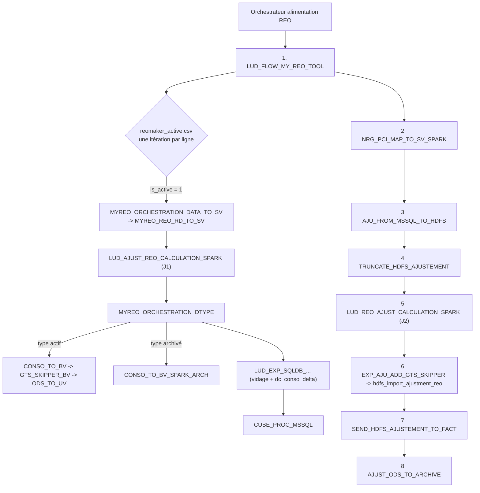
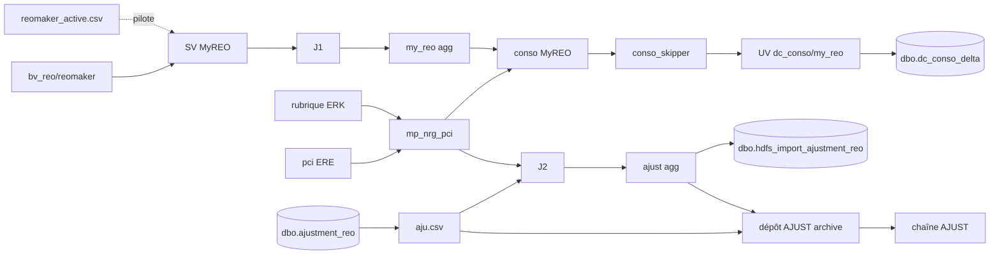

# Analyse de l'orchestrateur Talend d'alimentation REO (v0.1)

Source analysée : export de l'orchestrateur Talend d'alimentation REO (Talend 8, projet BSY_A2918, dossier `LUD_MINI_CHAINE_REO`).
L'export contient le `.item` de l'orchestrateur, ses contextes, et 20 jars : l'orchestrateur et ses 19 jobs enfants. Les jobs enfants n'y figurent que sous forme compilée.
Méthode : lecture du `.item` et des contextes, puis décompilation des 20 jars (CFR) pour la logique exacte de chaque composant. Les contextes des jobs Spark, absents de l'export, ont été lus dans leurs jars.

Aucun mot de passe ni compte SQL Server n'est recopié dans ce document. Les comptes sont désormais lus dans Vault (voir le document de conception).

## 1. Contenu de l'export

| Bloc | Job | Type | Rôle |
|---|---|---|---|
| | Orchestrateur d'alimentation REO | Standard | Orchestrateur : 8 tRunJob en séquence |
| MyREO | `LUD_FLOW_MY_REO_TOOL` | Standard | Sous-orchestrateur, piloté par `reomaker_active.csv` |
| MyREO | `MYREO_ORCHESTRATION_DATA_TO_SV` | Standard | Listing du dépôt MyREO (sans usage), appel de `MYREO_REO_RD_TO_SV` |
| MyREO | `MYREO_REO_RD_TO_SV` | Standard | `bv_reo/reomaker/reomaker.csv` vers le fichier SV MyREO |
| MyREO | `LUD_AJUST_REO_CALCULATION_SPARK` | Spark | Ventilation des ajustements MyREO (J1) |
| MyREO | `MYREO_ORCHESTRATION_DTYPE` | Standard | Boucle sur le référentiel des types |
| MyREO | `LUD_AJUST_REO_CONSO_TO_BV_SPARK` | Spark | Table NRG vers PCI, puis conso MyREO par type actif |
| MyREO | `REO_CONSO_ADD_GTS_SKIPPER_TO_BV_SPARK_MY_REO` | Spark | Enrichissement GTS Skipper |
| MyREO | `REO_CONSO_ADD_GTS_SKIPPER_ODS_TO_UV_SPARK_MY_REO` | Spark | Fait UV `dc_conso/my_reo` |
| MyREO | `AJUST_REO_CONSO_TO_BV_SPARK_ARCH` | Spark | Archivage des types inactifs |
| MyREO | `LUD_EXP_SQLDB_CONSO_DATA_REO_FROM_UV_TO_MSSQL_STOCK` | Standard | Fait UV vers `dbo.dc_conso_delta` |
| MyREO | `TRUNCATE_CONSO_REO_PROC_MSSQL` | Standard | Procédure `p_api_truncate_tables_conso_delta` |
| MyREO | `CUBE_PROC_MSSQL` | Standard | Procédure `p_api_launch_Delta_process` |
| | `LUD_AJUST_REO_NRG_PCI_MAP_TO_SV_SPARK` | Spark | Table de correspondance NRG vers PCI |
| SQL Server | `LUD_REO_AJU_FROM_MSSQL_TO_HDFS` | Standard | `dbo.ajustment_reo` vers `wp_reo/ajust/aju/sql/aju.csv` |
| SQL Server | `LUD_REO_TRUNCATE_HDFS_AJUSTEMENT_TO_FACT_TABLE` | Standard | Procédure `p_api_truncate_table_hdfs_ajustment_reo` |
| SQL Server | `LUD_REO_AJUST_CALCULATION_SPARK` | Spark | Ventilation des ajustements SQL Server (J2) |
| SQL Server | `LUD_REO_EXP_AJU_ADD_GTS_SKIPPER_FROM_HDFS_TO_MSSQL` | Standard | Agrégat enrichi vers `dbo.hdfs_import_ajustment_reo` |
| SQL Server | `LUD_REO_SEND_HDFS_AJUSTEMENT_TO_FACT` | Standard | Procédure `p_api_send_hdfs_ajustment_reo_to_fact` |
| SQL Server | `LUD_REO_AJUST_ODS_TO_ARCHIVE` | Standard | Copie vers le dépôt `wp_reo/ajust/aju/archive` de la chaîne AJUST |

Soit 7 jobs Spark et 12 jobs Standard, dont 7 en échange avec SQL Server (pilote jTDS, autocommit).

## 2. Enchaînement

Tous les tRunJob sont en processus indépendant, avec `DIE_ON_CHILD_ERROR` et `TRANSMIT_WHOLE_CONTEXT`. Ils passent tous `--context=DEV` en dur : le job enfant charge son contexte DEV, puis le contexte du parent l'écrase. **Une clé absente de toute la lignée garde sa valeur DEV, même en production.** C'est le cas de `IPF_RD_ROOT_PATH_IN` (dépôt MyREO listé en `/dev/raw/...`) et de `AJU_REO_IN` de J1 (voir le chapitre 7).

Inactifs dans le `.item` : chargement du contexte depuis un fichier, notification mail, `LUD_SEND_AJUSTEMENT_TO_EXPORT` et le joblet de collecte des logs.

## 3. Détail par job

### 3.1 Bloc MyREO

| Job | Entrée | Sortie | Règles |
|---|---|---|---|
| MY_REO_TOOL | `wp_reo/params/reomaker/reomaker_active.csv` (`reomaker;is_active`) | | Une exécution des 5 jobs suivants par ligne où `is_active` vaut exactement `"1"`. La valeur `reomaker` n'est jamais transmise : K lignes actives relancent K fois la même chaîne |
| DATA_TO_SV | dépôt `raw/.../ajust/AJU_RES_CLE` (figé en DEV) | liste NEW, ligne `;;1` dans l'historique MYREO | La liste NEW n'est plus relue. Seul effet utile : l'appel de RD_TO_SV avec `filePath = /reomaker/reomaker.csv`, `parentPath = bv_reo` |
| RD_TO_SV | `bv_reo/reomaker/reomaker.csv`, 1 ligne d'en-tête ; référentiel `erk_a2832/ajust/dtype` | `sv_reo/my_reo/Extract_Ajus_Outil_REO_pour_BSY_REO.csv` | Valeurs brutes (sans retrait de guillemets), `Period = year + month`, `Data_Source = REOMAKER`, montant `parseTo_Double` strict (vide -> null), une ligne par type actif |
| J1 CALCULATION | fichier SV MyREO ; paramètres `params/aju/m_*.csv`, `params/etp/mapping_*`, `year_mapping.txt` | `wp_reo/my_reo/aju/ventil/*.csv` (14), `wp_reo/my_reo/aju/agg/aju_agg.csv` | Voir 3.3 |
| DTYPE | référentiel des types | | Même boucle que le dispatch AJUST : `is_active = 1` -> conso, GTS, UV ; `0` -> archivage |
| CONSO_TO_BV | `my_reo/aju/agg/aju_agg.csv` ; table NRG -> PCI | `wp_reo/my_reo/conso_reo/<dtype>` (Parquet) | Recalcule la table NRG -> PCI (identique au job NRG_PCI_MAP). Code PCI = compte du lookup unique `code_nrg = Indicateurs` (NRG900 -> NRG0900). Filtre A0 à A2, **sans agrégation**. Montant lu en `DECIMAL(17,12)` |
| GTS_SKIPPER_BV | conso ; PCI, type de CA, skipper, CA x sous-NRG | `wp_reo/my_reo/conso_skipper/<dtype>` | Comme AJUST, sauf la classification : clé `(code_snrg, code_centre_activite)` et non `Code_CA`, `NA` seulement si vide (la valeur `"NULL"` est gardée). Sorties de mise au point `ods/temp/sortie1.csv`, `sortie2.csv` |
| ODS_TO_UV | conso enrichie ; 14 référentiels UV | `uv_reo/dc_conso/my_reo/conso_reo.csv` | Code super-phase suffixé `_CST` en EUROCST ; `NC` si inconnu ou LMLOCAL ; 14 lookups identiques à AJUST ; filtre final : les 14 clés et le montant non nuls |
| ARCH | `wp_reo/my_reo/conso_reo/<dtype>` | `bv/conso_bigms/my_reo/<dtype>` (HOM : `bv_reo`) | Même requête que l'archivage AJUST |
| LUD_EXP + TRUNCATE_CONSO | fait UV MyREO | `dbo.dc_conso_delta` | Procédure de vidage, puis INSERT par lots de 10 000, `DIE_ON_ERROR = false` : erreurs de lot ignorées |
| CUBE | | | Procédure `p_api_launch_Delta_process`, sans timeout |

### 3.2 Table NRG -> PCI et bloc SQL Server

| Job | Entrée | Sortie | Règles |
|---|---|---|---|
| NRG_PCI_MAP | `erk_a2832/rubrique/rubrique.csv` (44 colonnes), `ere_a2309/pci/pci.csv` | `sv_reo/erk_a2832/ajust/mp_nrg_pci/{equal,diff}`, `wp_reo/ods/mp_nrg_pci/diff/{diff,diff9}` | `equal` : comptes dont le numéro est le sous-NRG. `diff` (comptes en 9) et `diff9` (autres, noms inversés) : un compte par sous-NRG, plus petit `pci_id`. `mp_nrg_pci/diff` : sous-NRG absents de `equal`, comptes hors classe 9 |
| AJU_FROM_MSSQL | `select * from dbo.ajustment_reo` (20 colonnes, lues par position) ; référentiel des types | `wp_reo/ajust/aju/sql/aju.csv` | Jointure interne `ALL_MATCHES` sur les types actifs ; `is_cancel_row` ni filtré ni écrit ; montants en `Double.toString`, date `dd-MM-yyyy` |
| TRUNCATE_HDFS | | | Procédure `p_api_truncate_table_hdfs_ajustment_reo` |
| J2 CALCULATION | `aju.csv` ; `mp_nrg_pci/equal` ; mêmes paramètres que J1 | `wp_reo/ajust/aju/ventil/*.csv`, `wp_reo/ajust/aju/agg/aju_agg.csv` | Voir 3.3 |
| EXP_AJU_ADD_GTS | `aju_agg.csv` ; PCI, type de CA, skipper, CA x sous-NRG (sans TRIMALL) | `dbo.hdfs_import_ajustment_reo` (23 colonnes) | Clé type de CA sans TRIM ; super-phase calculée ici (`NC` pour LMLOCAL et le cas résiduel, `_CST` pour EUROCST) ; classification sur `code_centre_activite` ; lots de 50 000 |
| SEND_TO_FACT | | | Procédure `p_api_send_hdfs_ajustment_reo_to_fact` |
| ODS_TO_ARCHIVE | `aju.csv`, `aju_agg.csv` | `wp_reo/ajust/aju/archive/sql/sql_reo.csv`, `.../agg/agg_reo.csv` | Recopie 1 pour 1, décimaux à 16 décimales, UTF-8. **C'est le producteur du dépôt lu par la chaîne AJUST** |

### 3.3 Ventilation (J1 et J2)

Les deux jobs ont la même topologie : 14 fichiers intermédiaires, puis la somme de tout le dossier par axe.

1. **Démultiplication des conversions.** J1 : chaque ligne sort avec sa conversion d'origine, puis `LMLOCAL` et `EUROCST`, au même montant. J2 : `LMLOCAL` = `lmlocal`, `EUROHIST` et `EUROCST` = `eurohist`. J2 remplace ensuite toujours l'indicateur, le NRG et le sous-NRG par ceux de `mp_nrg_pci/equal` (lookup unique sur le compte, null sans correspondance).
2. **YTD -> MTD hors effectifs** (`substr(indicateur,1,2) <> 'GD'`) : jointure `substr(période,-2) = m_mtd.source`, période cible = année + `trim(cible)`, montant × facteur en `MathContext.DECIMAL64`.
3. **MTD -> QTD, FQ, FY** par `m_qtd`, `m_fq`, `m_fy`, sans facteur. J2 : FY produits à partir de `201810` (`Integer.parseInt`).
4. **Effectifs (GD\*)** : recopie MTD et QTD ; FQ et FY décalés par les correspondances ETP datées (`year_code` + décalage), taux ignoré ; GD1 -> GD2 au taux (`DECIMAL32`), puis QTD et YTD au taux, puis FQ et FY : au taux en J2, sans taux en J1. J2 écrase aussi NRG, sous-NRG et PCI des lignes dérivées par le code indicateur.
5. **Agrégat** : somme par axe (9 en J1, 18 en J2), `DECIMAL(32,16)`, montants nuls écartés.

## 4. Fichiers et chemins

| Donnée | Chemin PROD | Producteur | Consommateurs |
|---|---|---|---|
| Pilotage | `wp_reo/params/reomaker/reomaker_active.csv` | externe, inconnu | MY_REO_TOOL |
| Extraction REOMAKER | `bv_reo/reomaker/reomaker.csv` | externe, inconnu | RD_TO_SV |
| SV MyREO | `sv_reo/my_reo/Extract_Ajus_Outil_REO_pour_BSY_REO.csv` | RD_TO_SV **et la chaîne MYREO** | J1 |
| Agrégat MyREO | `wp_reo/my_reo/aju/agg/aju_agg.csv` | J1 | CONSO_TO_BV |
| Conso, enrichi, archive MyREO | `wp_reo/my_reo/conso_reo/<dtype>`, `.../conso_skipper/<dtype>`, `bv/conso_bigms/my_reo/<dtype>` | CONSO, GTS, ARCH | GTS, UV |
| Fait UV MyREO | `uv_reo/dc_conso/my_reo/conso_reo.csv` | ODS_TO_UV | LUD_EXP |
| Table NRG -> PCI | `sv_reo/erk_a2832/ajust/mp_nrg_pci/{equal,diff}` | NRG_PCI_MAP et CONSO_TO_BV | CONSO_TO_BV, J2 |
| Extraction SQL Server | `wp_reo/ajust/aju/sql/aju.csv` | AJU_FROM_MSSQL | J2, ODS_TO_ARCHIVE |
| Agrégat ajustements | `wp_reo/ajust/aju/agg/aju_agg.csv` | J2 | EXP_AJU, ODS_TO_ARCHIVE |
| Dépôt AJUST | `wp_reo/ajust/aju/archive/{sql,agg}` | ODS_TO_ARCHIVE | **chaîne AJUST** (dispatch) |

En DEV, les racines UV ERE, ERK, GZH et la racine SV ERK sont nommées à l'envers (`a2309_ere`, `a2832_erk`, `a2835_gzh`). En HOM, les lookups GTS sont lus dans `wp_reo` au lieu de `wp`, et l'archive MyREO part dans `bv_reo`.

## 5. Lignage des données

## 6. Sémantique Talend à préserver

- **Jobs Spark** : un champ CSV vide est lu null ; **jobs Standard** (tHDFSInput) : il vaut `""`, et une clé vide correspond à une clé vide. Les égalités `SG_StringUtils.equals` sont null-safe.
- **Arrondis par ligne** : `multiply(x, DECIMAL64)` pour la ventilation MTD, `DECIMAL32` (7 chiffres significatifs) pour les dérivations d'effectifs. Chaque fichier intermédiaire est relu en `DECIMAL(32,16)`.
- **Montants texte** : `Double.toString` dans le SV MyREO et `aju.csv` ; `BigDecimal` à 16 décimales dans le dépôt AJUST.
- **Correspondances uniques** : une ligne arbitraire par clé chez Talend ; à rendre déterministe.
- **CHANGE(x, "GD1", "GD2")** : `replaceAll` par expression régulière.
- **Ordre** : la conso MyREO n'est pas filtrée par type : tous les dossiers actifs reçoivent le même contenu, et le fait UV, commun, est réécrit à chaque type.

## 7. Anomalies et risques relevés

| # | Gravité | Constat | Impact |
|---|---|---|---|
| 1 | Bloquant probable | J1 lit `BSY_ROOT_SV_REO + AJU_REO_IN` avec `AJU_REO_IN` = deux tabulations (valeur DEV, jamais surchargée) | Chemin inexistant : J1, MY_REO_TOOL et toute la chaîne devraient échouer. À vérifier dans les logs YARN de production |
| 2 | Élevée | Dépôt MyREO listé sur `/dev/raw/...` même en production (`IPF_RD_ROOT_PATH_IN` figé en DEV) | Échec si le dossier n'existe pas ; sinon liste NEW de la chaîne MYREO écrasée avec des chemins DEV |
| 3 | Élevée | Fichier SV MyREO commun aux chaînes MYREO et ALIM, en écrasement | La dernière chaîne exécutée gagne (`MYREO_TOOL` contre `REOMAKER`) |
| 4 | Élevée | Liste NEW et historique MYREO modifiés par ALIM (ligne `;;1` à chaque passage) | Collision avec la chaîne MYREO, croissance non bornée de l'historique |
| 5 | Moyenne | K lignes actives dans `reomaker_active.csv` : K exécutions du bloc MyREO, K² de RD_TO_SV | Même état final, coût multiplié ; colonne `reomaker` sans effet |
| 6 | Élevée | Conso MyREO : montant lu en `DECIMAL(17,12)` (moins de 100 000 en valeur absolue) | Montants plus grands perdus ou en erreur selon le lecteur Talend : à vérifier sur données réelles |
| 7 | Élevée | Taux des correspondances `gd2_qtd_fq` et `gd2_ytd_fy` appliqué en FQM / FYM par J2, ignoré par J1 | Une des deux versions est probablement fautive ; sans effet si le taux vaut 1 |
| 8 | Élevée | Plusieurs jobs SQL Server sortent en code 0 sur erreur (AJU_FROM_MSSQL, EXP_AJU) ; lots en échec ignorés (LUD_EXP) ; codes retour des procédures jamais testés | Chargements vides ou partiels sans alerte ; la chaîne continue |
| 9 | Élevée | Vidages (`p_api_truncate_*`) avant lecture ou contrôle, en autocommit | Une erreur laisse la table vide |
| 10 | Moyenne | Classification MyREO jointe sur `code_centre_activite` (AJUST : `Code_CA`), `"NULL"` gardé | Divergence volontaire ou copie fautive : à confirmer par le métier |
| 11 | Moyenne | Dépôt AJUST écrit en UTF-8, lu en ISO-8859-15 par le dispatch AJUST | Accents abîmés dans `comment` et `input_user` |
| 12 | Moyenne | Fait UV MyREO : lignes à dimension inconnue supprimées sans trace (tSqlRow_3) | Montants perdus en silence |
| 13 | Moyenne | Fichiers de sortie ouverts en écrasement avant la lecture (SV MyREO, `aju.csv`, dépôt AJUST) | Une erreur de lecture laisse une sortie vide, dont le dépôt lu par AJUST |
| 14 | Moyenne | J1 et J2 somment tout le dossier `ventil` | Un fichier résiduel fausse l'agrégat |
| 15 | Moyenne | `tContextDump` avec `HIDE_PASSWORD = false` dans plusieurs jobs | Mots de passe SQL Server probablement en clair dans les logs d'exécution |
| 16 | Faible | Table NRG -> PCI calculée deux fois par run (dans chaque conso MyREO, puis par NRG_PCI_MAP), écriture dans la zone SV ERK partagée | Coût et fenêtre de lecture incohérente |
| 17 | Faible | `is_cancel_row` lu mais ni filtré ni écrit | Ajustements annulés transmis au calcul : à confirmer |
| 18 | Faible | Aucun timeout SQL, notamment sur `p_api_launch_Delta_process` | Blocage possible de la chaîne |
| 19 | Info | Sorties de mise au point `ods/temp/sortie1.csv` et `sortie2.csv` sans consommateur | Non reprises |
