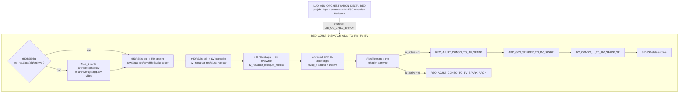
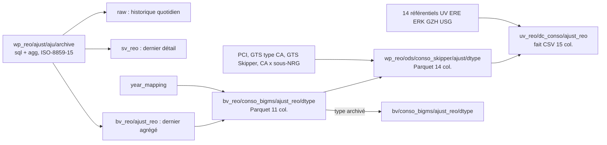

# Analyse du job Talend LUD_AJU_ORCHESTRATION_DELTA_REO (v0.1)

Source analysée : export `project_existant/LUD_AJU_ORCHESTRATION_DELTA_REO_0.1` (Talend 8.0.1, projet BSY_A2918, branche `new_lucid_reo8`, contexte d'export HOM).
Méthode : lecture des `.item` (XML des jobs), des contextes, des routines, puis contrôle du bytecode des jars générés pour les points ambigus (moteur de jointure, compression, formatage des décimaux, types primitifs).

## 1. Contenu de l'export

| Job | Type | Rôle | Composants |
|---|---|---|---|
| `LUD_AJU_ORCHESTRATION_DELTA_REO` | Standard | Orchestrateur : logs, contexte, connexion HDFS Kerberos, appel du dispatch | 15 |
| `REO_AJUST_DISPATCH_ODS_TO_RD_SV_BV` | Standard | Dispatch des fichiers d'ajustement, puis boucle sur les types de données | 38 |
| `REO_AJUST_CONSO_TO_BV_SPARK` | Spark Batch | Conso BV des ajustements, par type actif | 7 |
| `REO_AJUST_CONSO_TO_BV_SPARK_ARCH` | Spark Batch | Archivage de la conso d'un type inactif vers la BV principale | 5 |
| `LUD_REO_AJUST_CONSO_ADD_GTS_SKIPPER_TO_BV_SPARK` | Spark Batch | Enrichissement PCI, type de CA, GTS Skipper, classification | 11 |
| `LUD_REO_AJUST_DC_CONSO_GTS_SKIPPER_BV_TO_UV_SPARK_SP` | Spark Batch | Fait `dc_conso` UV : résolution des clés de 14 dimensions | 34 |

Socle technique embarqué : joblet `A2918_BSY_LOGS_COLLECTOR` (tLogCatcher, tStatCatcher, tFlowMeterCatcher) qui appelle `MONITORING_LOG`, `MONITORING_STAT`, `MONITORING_FLOW_METER` et `KAFKASINC_STAT` (envoi Kafka). Routines `SG_StringUtils`, `SG_NumberUtils`, `SG_Validate`, `SG_CharUtils`, `SG_CharSequenceUtils`, `Date_Utils`. Contextes DEV, INT, HOM, PROD (et un contexte `homo` résiduel).

## 2. Enchaînement



Chaque tRunJob est en `USE_INDEPENDENT_PROCESS`, `TRANSMIT_WHOLE_CONTEXT` et `DIE_ON_CHILD_ERROR`. Le type de données courant est passé aux jobs Spark par le paramètre de contexte `dtype` (= `data_type_code_lvl_2`). Chaque job Spark est une application YARN distincte : trois démarrages YARN par type actif, un par type archivé.

## 3. Détail par job

### 3.1 Orchestrateur `LUD_AJU_ORCHESTRATION_DELTA_REO`

- Prejob : `tFixedFlowInput` + `tJavaRow` (nom du job, version, PID) vers `tLogRow`, puis `tContextDump` vers `tLogRow`.
- `tHDFSConnection` Kerberos (principal et keytab du contexte, propriétés HA HDFS et YARN), `tDie` en cas d'échec.
- Sous-job principal : `tWarn` "Job is started", `tSetGlobalVar` (`jobStatus = 9`, `subJobName = "150 - Check new AJUST file on Raw Data"`), puis `tRunJob` du dispatch.
- Postjob : `tWarn` "terminated with status code". Aucune transformation de données.

### 3.2 Dispatch `REO_AJUST_DISPATCH_ODS_TO_RD_SV_BV`

| Sous-job | Composants | Entrée | Sortie | Règle |
|---|---|---|---|---|
| Amorçage | tHDFSExist_1, tHDFSInput_5, tMap_5, tHDFSOutput_4/5 | `wp_reo/ajust/aju/archive` | `archive/sql/sql.csv`, `archive/agg/agg.csv` | Si le dépôt n'existe pas, deux fichiers vides sont créés (filtre `data_type_code_lvl_1 == ""` en comparaison de références Java, toujours faux) |
| Historique RD | tHDFSList_1, tHDFSInput_1, tMap_1, tHDFSOutput_1 | `archive/sql/*` | `raw/basycout/ajust_reo/<yyyyMMdd>/aju_<yyyyMMddHHmmss>.csv` | APPEND de chaque fichier, tri par nom croissant, `*.txt` exclus |
| SV | tHDFSList_2, tHDFSInput_2, tMap_2, tHDFSOutput_2 | `archive/sql/*` | `sv_reo/ajust_reo/ajust_reo.csv` | OVERWRITE à chaque itération : seul le dernier fichier subsiste |
| BV | tHDFSList_3, tHDFSInput_3, tMap_3, tHDFSOutput_3 | `archive/agg/*` | `bv_reo/ajust_reo/ajust_reo.csv` | Idem, dernier fichier agrégé |
| Référentiel | tHDFSInput_4, tMap_4, tHashOutput_1 | `erk_a2832/ajust/dtype` (SV ERK) | mémoire | `active = is_active == 1`, `archive = is_active == 0` |
| Boucle | tHashInput_1, tFlowToIterate_1, tJava_1, tRunJob_1/3/4/5, tHDFSDelete_2 | | | Un passage par ligne du référentiel |

Formats des fichiers AJUST (séparateur `;`, sans en-tête, ISO-8859-15 en entrée, UTF-8 en sortie) :

- fichier détail "sql" : `ajustment_id;perimeter;phase;periode;cumul;data_type;data_source;entity;indicator;ssbu;nrg;snrg;pci;activity_center;eurohist;lmlocal;comment;input_user;input_date` ;
- fichier agrégé "agg" : mêmes 14 premières colonnes, puis `conversion;amount;comment;input_user;input_date`.

Les tMap_1/2/3 sont de simples recopies, mais le couple tHDFSInput/tHDFSOutput reparse puis resérialise chaque champ (vérifié dans le bytecode) : `ajustment_id` via `parseTo_int`, montants via `parseTo_BigDecimal` puis `setScale(16, HALF_UP).toPlainString()`. La copie n'est donc pas octet pour octet. La case "Compress" est décochée partout : le paramètre `COMPRESSION = GZIP` affiché est inactif, tous les fichiers sont en texte brut.

### 3.3 `REO_AJUST_CONSO_TO_BV_SPARK`

```
tFileInputDelimited_1 (bv_reo/ajust_reo, ';', UTF-8) -> tMap_1 -> tSqlRow_1 (+ year_mapping) -> tAggregateRow_1 -> tFileOutputParquet_1
```

- tMap_1 : `periode_annee = substring(periode, 0, 4)`, `period_mois = substring(periode, -2)`, renommage des autres colonnes vers le format conso (`code_entite`, `code_conversion`, `code_pci`, `phase_code`, `cumul_code`, `slm_activite_code`, `data_type_code`, `data_source_code`, `montant`).
- tSqlRow_1 : `to_agg LEFT JOIN map ON periode_annee = year_code WHERE relative_year_code IN ('A0','A1','A2')`, soit une jointure interne sur les années A0 à A2 du fichier `wp_reo/params/super_phase/year_mapping.txt` (en-tête 1 ligne).
- tAggregateRow_1 : somme de `montant` (précision financière, null ignorés) par les dix axes.
- Sortie : Parquet non compressé `bv_reo/conso_bigms/ajust_reo/<dtype>`, en écrasement.
- **Aucun filtre sur le type de données** : chaque type actif reçoit le contenu complet du fichier BV.

### 3.4 `REO_AJUST_CONSO_TO_BV_SPARK_ARCH`

```
tFileInputParquet_1 (bv_reo/conso_bigms/ajust_reo/<dtype>) -> tSqlRow_1 (+ year_mapping) -> tFileOutputParquet_1 (bv/conso_bigms/ajust_reo/<dtype>)
```

Même filtre d'années que la conso, rejoué à chaque exécution : quand la fenêtre A0..A2 avance, les années sorties disparaissent de l'archive. En HOM, la sortie est `bv_reo/conso_bigms/ajust_reo_arch/<dtype>`.

### 3.5 `LUD_REO_AJUST_CONSO_ADD_GTS_SKIPPER_TO_BV_SPARK`

| tMap | Lookup (fichier, séparateur, trim) | Clé lookup = expression flux principal | Sortie |
|---|---|---|---|
| tMap_4 | PCI `ere_a2309/pci/pci.csv`, `\|`, sans trim | `Numero_compte = code_pci` | `Code_Nrg = Code_Sous_nrg` |
| tMap_5 | `wp/ods/map_gts_type_ca/map_gts_type_ca.csv`, `;`, TRIMALL | `CODE_CA0 = trim(slm_activite_code)` | `CODE_TYPE_CA` (vide ou absent -> `NA`), `LABEL_TYPE_CA = trim(...)` |
| tMap_6 | `wp/ods/map_gts_skipper/map_gts_skipper.csv`, `;`, TRIMALL | `NRG_CODE = trim(Code_Nrg)` et `LABEL_TYPE_CA = trim(LABEL_TYPE_CA)` | `CODE_GTS_N2` (vide ou absent -> `NA`), `CODE_TYPE_CA = trim(...)` |
| tMap_1 | `wp/ods/mvt_map_ca_nrg/ca/*`, `;`, TRIMALL | `Code_CA = slm_activite_code` et `code_snrg = Code_Nrg` | `Code_classification` ("NULL" sans casse ou vide -> `NA`) |

Sortie : Parquet `wp_reo/ods/conso_skipper/ajust/<dtype>`, 14 colonnes (la colonne de travail `Code_Nrg` n'est pas écrite). Les lookups utilisent le moteur HMap de Talend en `LEFT_OUTER` et `UNIQUE` (bytecode).

### 3.6 `LUD_REO_AJUST_DC_CONSO_GTS_SKIPPER_BV_TO_UV_SPARK_SP`

- tSqlRow_1 : `super_phase_code = phase_cumul_année_Mxx` ; `M00` sauf cumul `FQ` en phase `RE`, où le mois donne `M03`, `M06`, `M09` ou `M12`.
- tSqlRow_2 : jointure SQL sur le référentiel super-phase ; code forcé à `NC` s'il est inconnu ou si la conversion n'est pas `EUROHIST`.
- 14 lookups HMap en `LEFT_OUTER` / `UNIQUE`, presque tous en "replicated join" (broadcast) :

| tMap | Référentiel UV | Sép. | Filtre du lookup | Clé (expression flux principal) | Sortie |
|---|---|---|---|---|---|
| 6 | `usg/synthese_cout_superphase/...` | `;` | | `super_phase_code` | `superphase_id` |
| 1 | `usg/synthese_cout_phase/...` | `;` | `isNotBlank(phase_code)` | `trim(phase_code)` | `phase_id` |
| 2 | `ere_a2309/pci` | `\|` | `isNotBlank(Numero_compte)` | `trim(code_pci)` | `pci_id` |
| 3 | `usg/synthese_cout_periode/...` | `;` | | `trim(periode_annee)`, `trim(period_mois)` | `periode_id` |
| 4 | `erk_a2832/activite` | `;` | `isNotBlank(code_centre_activite)` | `trim(slm_activite_code)` | `activity_id` |
| 5 | `erk_a2832/res07` | `\|` | `isNotBlank(CODE_CENTRE_ACTIVITE)` | `trim(slm_activite_code)` | `budget_id` |
| 8 | `usg/synthese_cout_cumul/...` | `;` | `isNotBlank(cumul_code)` | `trim(cumul_code)` | `cumul_id` |
| 9 | `gzh_a2835/ref/supervision` | `;` | | `GEN14 = trim(code_entite)`, vide -> `NA` | `entite_id` |
| 10 | `gzh_a2835/ref/conversion` | `;` | `isNotBlank(conversion_code_5)` | `trim(code_conversion)` | `conversion_id` |
| 11 | `erk_a2832/ajust/dtype/dtype.csv` | `;` | | `trim(data_type_code)` | `data_type_id` |
| 13 | `erk_a2832/ajust/dsource/dsource.csv` | `;` | | `data_source_code` | `data_source_id` |
| 7 | `erk_a2832/gts_skipper/gts_skipper.csv` | `;` | | `trim(code_gts_n2)` | `gts_skipper_id` |
| 12 | `erk_a2832/gts_type_ca/gts_type_ca.csv` | `;` | | `trim(code_type_ca)` | `gts_type_ca_id` |
| 14 | `erk_a2832/spe_imm/ref_classification/...` | `;` | | `Code_classification` | `Classification_Id` |

Sortie : CSV `uv_reo/dc_conso/ajust_reo`, séparateur `;`, sans en-tête, non compressé, en écrasement. Le dossier ne dépend pas du type : il est réécrit à chaque type actif. Les 15 colonnes sont 14 identifiants techniques et le montant : c'est la table de faits de l'étoile UV, dont les dimensions sont produites par les chaînes ERE, ERK, GZH et USG.

## 4. Lignage des données



## 5. Sémantique Talend à préserver

Points vérifiés dans les `.item` et dans le bytecode des jars :

- **Lecture brute** : "CSV options" décochées dans tous les tFileInputDelimited. Découpe simple sur le séparateur, sans guillemets d'encadrement ni échappement.
- **TRIMALL** actif sur les lookups GTS du job d'enrichissement et sur tous les référentiels UV sauf la classification ; inactif sur le fichier AJUST, `year_mapping` et le PCI du job d'enrichissement.
- **En-têtes** : seul `year_mapping` saute une ligne ; le paramètre est vide sur les référentiels conversion et classification, ce que Talend traite comme 0.
- **Lookups tMap** : moteur HMap en `LEFT_OUTER` + `UNIQUE`. En cas de doublon de clé, Talend garde une ligne arbitraire selon l'ordre physique.
- **Types primitifs** : `superphase_id` est un `int` non nullable en sortie de tMap_6 ; les autres identifiants sont des `Integer` nullables, donc null sans correspondance.
- **Dispatch** : décimaux réécrits avec 16 décimales en `HALF_UP`, entiers normalisés, ISO-8859-15 vers UTF-8, pas de compression.
- **Routines** : `SG_StringUtils.substring`, `trim`, `isBlank`, `equals`, `equalsIgnoreCase` suivent commons-lang3.

## 6. Anomalies et risques relevés

| # | Constat | Impact |
|---|---|---|
| 1 | La conso BV ne filtre pas sur le type de données | Tous les types actifs reçoivent le même contenu ; à confirmer avec le métier |
| 2 | SV et BV gardent le dernier fichier par ordre alphabétique | Plusieurs dépôts le même jour : seul le dernier compte pour la conso |
| 3 | Dépôt absent : création de fichiers vides puis traitement | SV, BV, la conso des types actifs et le fait UV deviennent vides |
| 4 | Le dossier UV est commun à tous les types et réécrit à chaque itération | Sans effet tant que le point 1 tient, incohérent sinon |
| 5 | Sans type actif, le dépôt n'est jamais supprimé | Le run suivant le réhistorise : doublons dans RD |
| 6 | Un type archivé sans dossier de conso fait échouer toute la chaîne | Selon l'ordre du référentiel, les types actifs ne sont pas traités |
| 7 | `is_active` vide : NullPointerException sur `row3.is_active == 1` | Arrêt de la chaîne |
| 8 | Jointures SQL "toutes correspondances" sur `year_mapping` et sur le référentiel super-phase | Une clé en double multiplie les montants |
| 9 | Contextes incohérents : HOM lit les lookups GTS dans `wp_reo`, archive dans `bv_reo/.../ajust_reo_arch` ; DEV inverse les noms des racines UV et lit l'archive dans `/my_reo` | Comportements différents selon l'environnement |
| 10 | Files YARN hors production empruntées à d'autres applications (`FHML_CORE_FNI_A8401_APP_P`, `INT_CORE_FII_A8690_FII_P`, `DEV_CORE_FNI_A8401_APP_P`) | Consommation imputée à d'autres projets |
| 11 | Ressources Spark surdimensionnées : driver 16 Go, exécuteurs jusqu'à 32 Go, pour des volumes d'ajustement faibles | Coût cluster et temps de démarrage |
| 12 | Notes de jobs copiées d'autres jobs (`GIZEH_SNAPSHOT_REF_RD_TO_SV`, "Split and Extract from ACPASTO file") | Documentation trompeuse |
