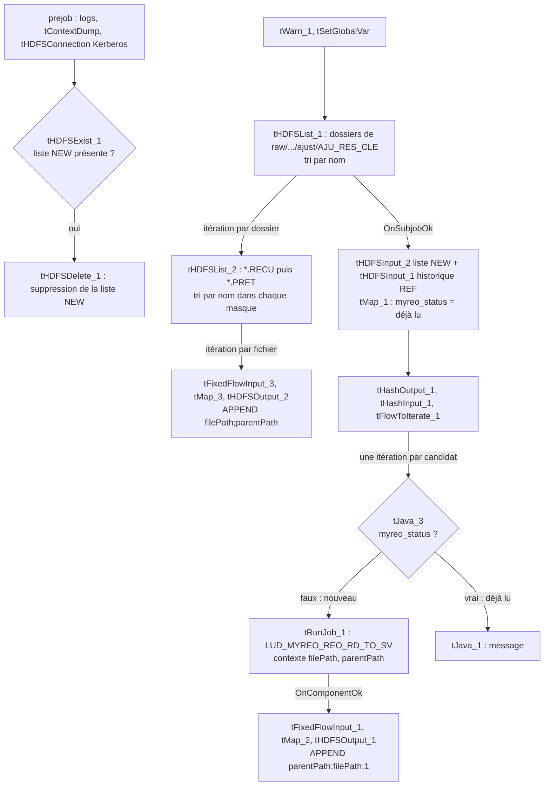
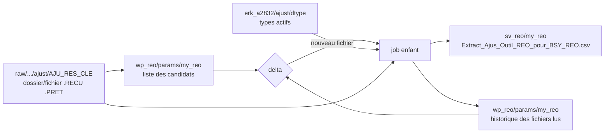

# Analyse du job Talend LUD_MYREO_ORCHESTRATION_DATA_TO_SV (v0.1)

Source analysée : export `project_existant/LUD_MYREO_ORCHESTRATION_DATA_TO_SV_0.1` (Talend 8.0.1, projet BSY_A2918, branche `new_lucid_reo8`, contexte d'export DEV).
L'export contient le `.item` de l'orchestrateur. Le job enfant n'y figure que sous forme de code Java généré et de jar : son analyse repose sur ce code.
Méthode : lecture du `.item` et des contextes, puis du code Java généré des deux jobs pour la sémantique exacte du listing, des lectures, de la jointure et des écritures.

## 1. Contenu de l'export

| Job | Type | Rôle | Composants |
|---|---|---|---|
| `LUD_MYREO_ORCHESTRATION_DATA_TO_SV` | Standard | Orchestrateur : listing du dépôt MyREO, delta contre l'historique des fichiers lus, appel du job enfant pour chaque nouveau fichier | 32 |
| `LUD_MYREO_REO_RD_TO_SV` | Standard | Extraction MyREO vers le fichier SV, multipliée par les types de données actifs | 4 de traitement, le reste en logs et connexion |

Les deux jobs sont des jobs Standard : aucune application Spark. Le job enfant porte des variables de contexte Spark et YARN héritées d'un modèle, inutilisées.
Le socle est le même que la chaîne AJUST : prejob de logs (`tFixedFlowInput`, `tJavaRow`, `tLogRow`, `tContextDump`), connexion HDFS Kerberos, `tWarn` de début et de fin.

## 2. Enchaînement



Le tRunJob est en `USE_INDEPENDENT_PROCESS`, `TRANSMIT_WHOLE_CONTEXT` et `DIE_ON_CHILD_ERROR`. Chaque nouveau fichier lance donc une JVM dédiée (`-Xms256M -Xmx1024M`), qui ouvre sa propre connexion Kerberos.

## 3. Détail par job

### 3.1 Orchestrateur `LUD_MYREO_ORCHESTRATION_DATA_TO_SV`

| Sous-job | Composants | Entrée | Sortie | Règle |
|---|---|---|---|---|
| Prejob | tPrejob_1, tFixedFlowInput_2, tJavaRow_1, tLogRow_1/2, tContextDump_1, tHDFSConnection_4, tDie_1, tHDFSExist_1, tHDFSDelete_1 | | | Logs, connexion HDFS, puis suppression de la liste NEW du run précédent |
| Listing | tHDFSList_1, tHDFSList_2, tFixedFlowInput_3, tMap_3, tHDFSOutput_2 | `raw/bsy_a2918/basycout/ajust/AJU_RES_CLE` | `wp_reo/params/my_reo/myreo_path_new_files.csv` | Une ligne `filePath;parentPath` par fichier, en APPEND |
| Delta | tHDFSInput_2, tHDFSInput_1, tMap_1, tHashOutput_1 | liste NEW, historique REF | mémoire | `myreo_status` vrai si le couple (dossier, fichier) figure dans l'historique |
| Boucle | tHashInput_1, tFlowToIterate_1, tJava_3, tRunJob_1, tJava_1 | | | Le job enfant n'est appelé que pour les fichiers non lus |
| Historique | tFixedFlowInput_1, tMap_2, tHDFSOutput_1 | contexte du fichier traité | `wp_reo/params/my_reo/myreo_path_ref_files.csv` | Une ligne `parentPath;filePath;1`, en APPEND après chaque appel réussi |

Points vérifiés dans le code généré :

- **tHDFSList_1** liste les dossiers DIRECTS du dépôt, sans récursion. Le tri est `String.compareTo` sur le nom, le masque `*` retient tout. Les fichiers posés à la racine du dépôt sont ignorés.
- **tHDFSList_2** liste les fichiers directs de chaque dossier, masque par masque : tous les `*.RECU` triés par nom, puis tous les `*.PRET`. Les masques passent par `GlobCompiler.globToPerl5` et s'appliquent au nom complet, casse comprise.
- **parentPath** vaut `FileStatus.getPath().toString()` du dossier, donc l'URI complète avec le nameservice (`hdfs://HDFS-LUDP01/prd/...`). C'est cette chaîne qui sert de clé dans l'historique.
- **Exclusion `*.txt`** : le masque est saisi mais la case `IFEXCLUDE` est décochée, il n'exclut rien.
- **Compression** : `COMPRESSION = GZIP` est affiché mais la case n'est pas cochée. Aucun codec n'est utilisé, tout est en texte brut.
- **tMap_1** : la liste NEW est le flux principal, l'historique le lookup en `ALL_MATCHES` sur `parentPath` et `filePath`. Le filtre de lookup `!equals(filePath, "") || filePath != null` est toujours vrai.
- **Liste NEW** : supprimée au prejob puis recréée par APPEND. Si le dépôt ne contient aucun fichier, elle n'est pas recréée et le tHDFSInput_2 suivant échoue.
- **Historique REF** : lu par `getFileStatus`. S'il est absent, le job échoue avant tout traitement : il a donc été initialisé à la main.

### 3.2 Job enfant `LUD_MYREO_REO_RD_TO_SV`

```
tHDFSInput_1 "my_reo_in" (fichier MyREO) --main--> tMap_1 --> tHDFSOutput_1 "my_reo_active" (fichier SV)
tHDFSInput_2 "data_type" (référentiel ajust/dtype) --lookup ALL_ROWS-->
```

- **Fichier lu** : `substringAfter(deleteWhitespace(context.parentPath), context.NameNodeUri_lucid) + "/" + context.filePath`. L'URI du nameservice est retirée du dossier, puis le nom du fichier est ajouté.
- **Lecture** : `FileInputDelimited(UTF-8, ";", "\n", skipEmptyRow = false, header = 1)`. Dix colonnes chaîne : `year;month;entity;conversion;nrg;phase;cumulated_type;activity_center;data_source;amount`. Les lignes vides sont conservées, un champ absent vaut `""`, jamais null.
- **Lookup** : `ERK_SV_ROOT_PATH_OUT + path_out_dtype` (`erk_a2832/ajust/dtype`), même référentiel que le dispatch AJUST. Il est lu sans en-tête, `is_active` passe par `parseTo_Integer`.
- **tMap_1** : lookup `ALL_ROWS` sans clé de jointure, avec le filtre `row1.is_active == 1`. Chaque ligne du fichier sort donc une fois par type actif.
  - Référentiel vide : Talend force un passage avec la ligne de lookup par défaut, d'où une ligne par ligne lue avec `Data_Type` null.
  - Référentiel sans type actif : aucune ligne en sortie.
  - `is_active` vide : le déballage de l'`Integer` lève une NullPointerException et le job s'arrête.

| Colonne SV | Expression Talend | Exemple |
|---|---|---|
| `Phase` | `SG_StringUtils.substring(phase, 1, -1)` | `"RE"` donne `RE` |
| `Period` | `substring(year, 1, -1) + substring(month, 1, -1)` | `"2026"` et `"04"` donnent `202604` |
| `Type_Cumul` | `substring(cumulated_type, 1, -1)` | `FY` |
| `Conversion` | `substring(conversion, 1, -1)` | `EUROHIST` |
| `Data_Type` | `row1.data_type_code_lvl_2` (type actif) | `AJU_REO_T2_2026` |
| `Data_Source` | constante `"MYREO_TOOL"` | `MYREO_TOOL` |
| `Entite` | `substring(entity, 1, -1)` | |
| `Centre_Activite` | `substring(activity_center, 1, -1)` | |
| `Indicateurs` | `substring(nrg, 1, -1)` | |
| `Montant_ajustement` | `SG_NumberUtils.toDouble(substring(amount, 1, -1))` | `"1234.5"` donne `1234.5` |

`SG_StringUtils.substring(x, 1, -1)` est la copie de commons-lang3 : il retire le premier et le dernier caractère, soit les guillemets posés par l'outil MyREO, et rend `""` sous trois caractères.
`SG_NumberUtils.toDouble` vaut `Double.parseDouble`, avec 0.0 si la valeur est nulle ou non numérique.
La colonne `data_source` du fichier est ignorée.

- **Écriture** : `fs.create(BSY_ROOT_SV_REO + AJU_REO_OUT, overwrite = true)`, soit `sv_reo/my_reo/Extract_Ajus_Outil_REO_pour_BSY_REO.csv`. Le fichier est en UTF-8, séparateur `;`, fin de ligne `\n`, sans en-tête. Une valeur null donne un champ vide et le Double est écrit par `StringBuilder.append`, donc en `Double.toString` : `1.23456789E7` au-delà de 10^7.

## 4. Fichiers et chemins

| Fichier | Chemin (contexte PROD) | Format |
|---|---|---|
| Dépôt MyREO | `/prd/raw/bsy_a2918/basycout/ajust/AJU_RES_CLE/<dossier>/<fichier>.RECU` ou `.PRET` | UTF-8, `;`, 1 ligne d'en-tête, 10 colonnes entre guillemets |
| Liste des candidats | `/prd/app/bsy_a2918/wp_reo/params/my_reo/myreo_path_new_files.csv` | `filePath;parentPath` |
| Historique des fichiers lus | `/prd/app/bsy_a2918/wp_reo/params/my_reo/myreo_path_ref_files.csv` | `parentPath;filePath;fileRead` |
| Référentiel des types | `/prd/srv/bsy_a2918/srv_bsy_a2918_basycout/erk_a2832/ajust/dtype` | `;`, 5 colonnes dont `is_active` |
| Fichier SV | `/prd/srv/bsy_a2918/srv_bsy_a2918_basycout/sv_reo/my_reo/Extract_Ajus_Outil_REO_pour_BSY_REO.csv` | `;`, 10 colonnes |

DEV, INT et HOM suivent le même schéma avec les préfixes `/dev`, `/int` et `/fhml`. Le contexte résiduel `homo` mélange le dépôt raw de DEV et les sorties de HOM.

## 5. Lignage des données



## 6. Sémantique Talend à préserver

- **Ordre des fichiers** : dossiers par nom, puis `*.RECU` avant `*.PRET`, puis nom. Il décide du fichier qui reste dans le SV.
- **Clé de l'historique** : URI complète du dossier et nom du fichier, comparés à l'identique, casse comprise.
- **Lecture du fichier MyREO** : coupure sur `\n` seulement, en-tête sauté, lignes vides conservées, découpe brute, champs absents à `""`.
- **Transformation** : premier et dernier caractère retirés, `Period` concaténé, `Data_Source` constant, montant à 0.0 s'il est invalide.
- **Types de données** : produit cartésien avec les types actifs, passage forcé si le référentiel est vide, arrêt si `is_active` est vide.
- **Écriture** : un seul fichier, réécrit à chaque appel du job enfant ; Double en `Double.toString`, null en champ vide.
- **Historique** : un fichier n'est marqué lu qu'après le succès de son appel au job enfant.

## 7. Anomalies et risques relevés

| # | Constat | Impact |
|---|---|---|
| 1 | Chaque appel du job enfant écrase le fichier SV | Avec plusieurs nouveaux fichiers dans un run, seul le dernier reste dans le SV alors que tous sont marqués lus. Les autres ne seront jamais rejoués. Cohérent seulement si chaque extraction est un instantané complet, à confirmer avec le métier |
| 2 | Produit cartésien avec tous les types actifs | Chaque ligne est dupliquée par type actif. Avec deux types actifs, une somme tous types confondus double les montants |
| 3 | `toDouble` écrit 0.0 sans alerte pour un montant invalide | Virgule décimale, séparateur de milliers ou guillemet manquant : montant perdu en silence |
| 4 | Fichier en fin de ligne CRLF | Le `\r` reste dans `amount` : tous les montants valent 0.0 |
| 5 | Historique absent ou dépôt vide | Le job échoue : le premier run exige un historique créé à la main, un dépôt vide fait tomber le traitement |
| 6 | Historique indexé sur l'URI complète du nameservice | Un changement d'URI du NameNode rend tous les fichiers nouveaux et les fait rejouer |
| 7 | Chemin du job enfant recalculé par `substringAfter(deleteWhitespace(parentPath), NameNodeUri)` | Un dossier contenant un espace, ou une URI différente du contexte, donne un mauvais chemin |
| 8 | Ligne vide dans l'extraction | Elle produit une ligne SV vide, hors type, `MYREO_TOOL` et montant 0.0 |
| 9 | `is_active` vide | NullPointerException : le run s'arrête après avoir pu écraser le SV et compléter l'historique pour les fichiers précédents |
| 10 | Historique en double | `ALL_MATCHES` produit une itération par doublon, sans effet sur les données |
| 11 | Une JVM et une connexion Kerberos par nouveau fichier | Temps de traitement proportionnel au nombre de fichiers |
| 12 | Libellés et notes copiés d'autres jobs : `NOSICA MVT`, `BILLERS`, sorties `gzh_new_file` et `to_billers_ref_file` | Documentation trompeuse |
| 13 | Masque d'exclusion `*.txt` et compression GZIP affichés mais inactifs | Configuration trompeuse à la lecture du job |
