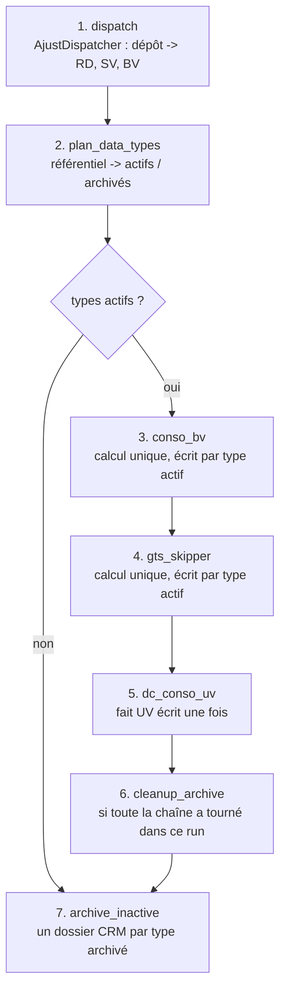
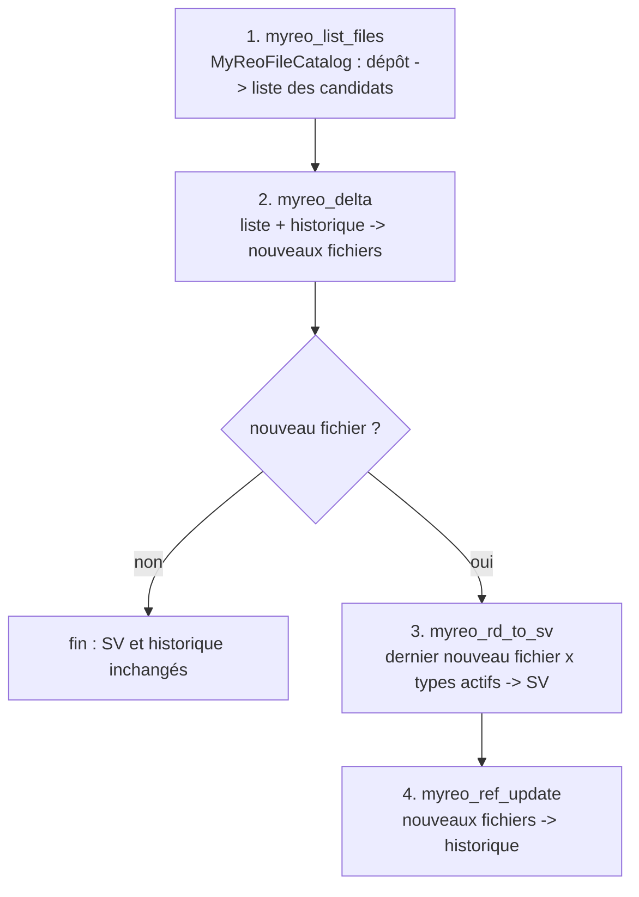

# Conception de la migration Scala / Spark des chaînes REO

Ce document décrit la cible des deux chaînes Talend migrées dans le projet `bsy_reo` :

- **AJUST** : `LUD_AJU_ORCHESTRATION_DELTA_REO`, analysée dans [ANALYSE_TALEND_LUD_AJU_ORCHESTRATION_DELTA_REO.md](ANALYSE_TALEND_LUD_AJU_ORCHESTRATION_DELTA_REO.md) ;
- **MYREO** : `LUD_MYREO_ORCHESTRATION_DATA_TO_SV`, analysée dans [ANALYSE_TALEND_LUD_MYREO_ORCHESTRATION_DATA_TO_SV.md](ANALYSE_TALEND_LUD_MYREO_ORCHESTRATION_DATA_TO_SV.md).

## 1. Principes

- **Même conception que le template FDA et EXP_ENG_FRG_SUV** : packages `job`, `common`, `mapping`, `utility` ; chaîne Driver -> FetchSource -> Runner -> Mapper (`AbstractMapperProvider`) -> requêtes Spark SQL d'un objet `Views` -> DataWriter.
- **Un projet, un driver par chaîne** : comme `MainDriverUV` et `MainDriverSUV` dans EXP_ENG_FRG_SUV, chaque chaîne a son driver, son FetchSource, son runner, ses mappers et son objet `Views`. Le socle est partagé.
- **Parité fonctionnelle avec Talend d'abord** : chaque requête cite le composant Talend qu'elle remplace ; les écarts sont listés au chapitre 9.
- **Corrections des faiblesses relevées sur EXP_ENG_FRG_SUV** : référentiels passés par nom et non par position, vues temporaires préfixées par mapper, garde-fou sur les racines partagées, configuration versionnée, tests de bout en bout.

## 2. Organisation du projet

| Élément | Commun | AJUST | MYREO |
|---|---|---|---|
| Driver | | `job.MainDriverAjustReo` | `job.MainDriverMyReo` |
| Sources | `utility.Utils` (lecteurs) | `common.FetchSourceAjustReo` | `common.FetchSourceMyReo` |
| Runner | `common.AbstractMapperProvider` | `common.AbstractPrimaryAjustReo`, `common.AjustReoRunner` | `common.AbstractPrimaryMyReo`, `common.MyReoRunner` |
| Mappers | | `mapping.MainMapperAjust*` | `mapping.MainMapperMyReo*` |
| Requêtes SQL | | `mapping.ViewsAjustReo` | `mapping.ViewsMyReo` |
| Constantes | `utility.ReoConstants` | `utility.AjustReoConstants` | `utility.MyReoConstants` |
| Schémas | `utility.CustomSchemaReo` (référentiel des types) | `utility.CustomSchemaAjustReo` | `utility.CustomSchemaMyReo` |
| Socle | `ReoConf`, `DataWriter`, `DataQuality`, `StepRunner`, `SparkSessionManager` | | |
| Configuration | un fichier par driver, même structure, lue par `ReoConf` | `conf/reo_ajust.conf` | `conf/reo_myreo.conf` |
| Lancement | `bin/run_reo.sh <chaine> <env> <conf>` | `ajust` | `myreo` |

Le référentiel des types de données ERK SV (`ajust/dtype`) est lu par les deux chaînes : sa table `REF_DATA_TYPE_SV` et son schéma sont dans le socle, et il est déclaré dans chacun des deux fichiers de configuration.

## 3. Chaîne AJUST : organisation des sous-jobs

### Avant / après

| | Talend | Scala |
|---|---|---|
| Applications | 2 jobs Standard + 4 jobs Spark : 3 applications YARN par type actif, 1 par type archivé | 1 application Spark |
| Passage des données | Fichiers Parquet relus entre jobs | DataFrames en mémoire, persistés ; relecture disque seulement en reprise |
| Conso et enrichissement | Recalculés pour chaque type actif | Calculés une fois, écrits dans le dossier de chaque type actif |
| Fait UV | Réécrit à chaque type actif dans le même dossier | Calculé et écrit une fois |
| Ordre | Ordre du référentiel, actifs et archivés mélangés | Chaîne des actifs d'abord, archivage ensuite |
| Reprise | Relance complète | Interrupteur par étape, l'étape suivante relit la sortie précédente sur disque |

Le calcul unique est strictement équivalent : le job Talend ne filtre pas les ajustements par type, donc tous les dossiers actifs reçoivent le même contenu (anomalie n°1 de l'analyse AJUST).

### Étapes

| Étape | Interrupteur | Remplace | Implémentation |
|---|---|---|---|
| 1 | `dispatch_trt` | sous-jobs fichiers du dispatch | `AjustDispatcher` (API FileSystem Hadoop) |
| 2 | toujours exécutée | tHDFSInput_4, tMap_4, tFlowToIterate | `AjustReoRunner.runDataTypePlan`, `DataTypePlan` |
| 3 | `conso_bv_trt` | REO_AJUST_CONSO_TO_BV_SPARK | `MainMapperAjustConsoBv` |
| 4 | `gts_skipper_trt` | LUD_REO_AJUST_CONSO_ADD_GTS_SKIPPER_TO_BV_SPARK | `MainMapperAjustConsoGtsSkipper` |
| 5 | `dc_conso_uv_trt` | LUD_REO_AJUST_DC_CONSO_GTS_SKIPPER_BV_TO_UV_SPARK_SP | `MainMapperAjustDcConsoUv` |
| 6 | `cleanup_archive_trt` | tHDFSDelete_2 | `AjustDispatcher.deleteArchive` |
| 7 | `archive_inactive_trt` | REO_AJUST_CONSO_TO_BV_SPARK_ARCH | `MainMapperAjustConsoArch` |

Le dispatch reste hors Spark : il copie et normalise des fichiers nommés, ce que l'API FileSystem fait exactement et sans fichiers `part-*`.

## 4. Chaîne MYREO : organisation des sous-jobs

### Avant / après

| | Talend | Scala |
|---|---|---|
| Applications | 1 job Standard + 1 JVM et 1 connexion Kerberos par nouveau fichier (tRunJob en processus indépendant) | 1 application Spark de petite taille (driver 2 Go) |
| Listing, liste des candidats, historique | tHDFSList, tHDFSInput, tHDFSOutput en APPEND | `MyReoFileCatalog` (API FileSystem), écriture temporaire puis renommage |
| Delta | tMap_1 en mémoire | requête `myreo_delta_sql` |
| Fichier SV | Réécrit pour chaque nouveau fichier : le dernier reste | Écrit une fois, à partir du dernier nouveau fichier |
| Historique | Complété fichier par fichier, après chaque appel du job enfant | Complété en une fois, seulement si le SV a été écrit dans le run |
| Reprise | Relance complète | Interrupteur par étape ; la liste des candidats est relue sur disque si le listing est désactivé |

Écrire le SV une seule fois donne exactement l'état final de Talend : chaque appel du job enfant écrasait le fichier, seul le dernier nouveau fichier dans l'ordre d'itération subsistait, et tous les nouveaux fichiers étaient marqués lus (anomalie n°1 de l'analyse MYREO).

### Étapes

| Étape | Interrupteur | Remplace | Implémentation |
|---|---|---|---|
| 1 | `myreo_list_files_trt` | tHDFSExist_1, tHDFSDelete_1, tHDFSList_1, tHDFSList_2, tMap_3, tHDFSOutput_2 | `MyReoFileCatalog.listCandidates`, `writeFileList` |
| 2 | toujours exécutée | tHDFSInput_2, tHDFSInput_1, tMap_1, tHashOutput_1 | `MainMapperMyReoDelta` |
| 3 | `myreo_rd_to_sv_trt` | tFlowToIterate_1, tRunJob_1 puis job enfant LUD_MYREO_REO_RD_TO_SV | `MainMapperMyReoRdToSv`, `DataWriter.writeSingleTextFile` |
| 4 | `myreo_ref_update_trt` | tFixedFlowInput_1, tMap_2, tHDFSOutput_1 | `MyReoFileCatalog.appendToRef` |

Le listing et l'historique restent hors Spark, comme le dispatch AJUST : ce sont des opérations sur des fichiers nommés. Le delta et la transformation sont en Spark SQL. Le fichier SV est écrit par Spark dans un dossier temporaire caché, puis le fichier `part-*` est renommé au nom attendu.

## 5. Architecture des classes

| Classe | Rôle | Équivalent template / EXP_ENG_FRG_SUV |
|---|---|---|
| `job.MainDriverAjustReo`, `job.MainDriverMyReo` | Point d'entrée d'une chaîne, orchestration des étapes, `run` testable | `MainDriver`, `MainDriverUV`, `MainDriverSUV` |
| `common.SparkSessionManager` | Session Spark, AQE, paramètres SQL par environnement | identique |
| `common.FetchSourceAjustReo`, `common.FetchSourceMyReo` | Une lazy val par source, options de lecture issues de la configuration | `FetchSource`, `FetchSourceUV` |
| `common.AbstractPrimaryAjustReo`, `common.AbstractPrimaryMyReo` | Exposent les sources, déclarent un traitement par sous-job | `AbstractPrimary`, `AbstractPrimaryUV` |
| `common.AjustReoRunner`, `common.MyReoRunner` | Instancient les mappers | `TemplateRunner`, `UvFrgRunner` |
| `common.AbstractMapperProvider` | Contrat d'un mapper | identique |
| `common.UvDimensions` | Les 14 référentiels UV passés par nom | nouveau |
| `common.StepRunner` | Traçage et fail-fast des étapes | remplace le socle de monitoring Talend |
| `mapping.MainMapperAjust*`, `mapping.MainMapperMyReo*` | Un mapper par job ou sous-job Talend de transformation | `MainMapper*` |
| `mapping.ViewsAjustReo`, `mapping.ViewsMyReo` | Toutes les requêtes Spark SQL d'une chaîne | `Views`, `ViewsUV`, `ViewsSUV` |
| `utility.CustomSchemaReo` et ses deux extensions | Schémas dans l'ordre exact des schémas Talend | `CustomSchemaUV` |
| `utility.ReoConf` | Lecture typée de la configuration, résolution des chemins | nouveau |
| `utility.Utils` | Lecteur CSV de la chaîne, lecteur ligne à ligne façon FileInputDelimited, formatage texte des lignes | `Utils` |
| `utility.DataWriter` | Écriture CSV, Parquet ou fichier texte unique, garde-fou des racines protégées | `DataWriter` |
| `utility.AjustDispatcher`, `AjustLineCodec` | Dispatch et normalisation des lignes AJUST | nouveau, règles pures testables comme `PoRefRules` |
| `utility.DataTypePlan` | Plan actifs / archivés AJUST | nouveau |
| `utility.MyReoFileCatalog` | Listing du dépôt MyREO, liste des candidats, historique des fichiers lus | nouveau |
| `utility.MyReoRules` | `SG_NumberUtils.toDouble` en UDF | nouveau |
| `utility.DataQuality` | Contrôles bloquants (`superphase_id`, `is_active`), alertes de doublons | nouveau |

## 6. Correspondance composants Talend -> Spark SQL

Chaîne AJUST, requêtes de `mapping/ViewsAjustReo.scala` :

| Job Talend | Composants | Requête |
|---|---|---|
| CONSO_TO_BV | tMap_1 | `conso_to_agg_sql` |
| CONSO_TO_BV | tSqlRow_1 | `conso_year_filter_sql` = `yearFilterSql(...)` |
| CONSO_TO_BV | tAggregateRow_1 | `conso_aggregate_sql` |
| CONSO_TO_BV_ARCH | tSqlRow_1 | `arch_year_filter_sql` |
| ADD_GTS_SKIPPER | tMap_4, tMap_5, tMap_6, tMap_1 | `gts_skipper_enrich_sql` (une CTE par tMap) |
| DC_CONSO_UV | tSqlRow_1 | `uv_super_phase_code_sql` |
| DC_CONSO_UV | tSqlRow_2 | `uv_super_phase_check_sql` |
| DC_CONSO_UV | tMap_6, 1, 2, 3, 4, 5, 8, 9, 10, 11, 13, 7, 12, 14 | `uv_dc_conso_sql` (une CTE `d_*` par référentiel) |

Chaîne MYREO, requêtes de `mapping/ViewsMyReo.scala` :

| Job Talend | Composants | Requête |
|---|---|---|
| Orchestrateur | tMap_1 (et filtre du tMap_3) | `myreo_delta_sql` |
| Job enfant | tHDFSInput_2 et filtre de lookup du tMap_1 | `myreo_active_types_sql` |
| Job enfant | tMap_1, sortie `out_aju_reo` | `myreo_rd_to_sv_sql` |
| Contrôle qualité | aucun équivalent Talend | `myreo_amount_check_sql` |

Règles de traduction :

| Talend | Spark SQL |
|---|---|
| Lookup tMap `LEFT_OUTER` + `UNIQUE` | `LEFT JOIN` sur un lookup dédoublonné par clé : `MIN(id)` ou `ROW_NUMBER() = 1` sur un ordre déterministe |
| Lookup tMap `ALL_ROWS` sans clé, avec filtre | `CROSS JOIN` sur la CTE filtrée ; ligne nulle ajoutée si le lookup est vide (passage forcé de Talend) |
| Filtre d'expression d'un lookup `isNotBlank(x)` | `WHERE x IS NOT NULL AND TRIM(x) <> ''` dans la CTE |
| "Use replicated join" | hint `/*+ BROADCAST(...) */` |
| `SG_StringUtils.trim(x)` | `TRIM(x)` |
| `SG_StringUtils.substring(x, 0, 4)` / `substring(x, -2)` | `SUBSTRING(x, 1, 4)` / `SUBSTRING(x, -2)` |
| `SG_StringUtils.substring(x, 1, -1)` | `SUBSTRING(x, 2, LENGTH(x) - 2)` |
| `SG_NumberUtils.toDouble(x)` | UDF `myreo_to_double` : `Double.parseDouble`, 0.0 par défaut |
| `x == null ? "" : x` puis `equals(.., "") ? "NA" : ..` | `CASE WHEN COALESCE(x, '') = '' THEN 'NA' ELSE x END` |
| tSqlRow | requête recopiée telle quelle, seuls les noms de vues changent |
| tAggregateRow `sum`, IGNORE_NULL | `SUM` + `GROUP BY`, recasté en `DECIMAL(32,16)` |
| tFileInputDelimited d'un job Spark, "CSV options" décochées | lecteur CSV Spark avec `quote = \u0000`, schéma imposé |
| FileInputDelimited d'un job Standard (lignes vides gardées, champ absent à `""`) | `Utils.readRawDelimited`, puis `COALESCE(x, '')` en tête de requête |
| TRIMALL | `ignoreLeadingWhiteSpace` / `ignoreTrailingWhiteSpace` |
| Ordre des lignes d'un job Standard | colonne `line_no`, `ORDER BY`, écriture par `coalesce(1)` |
| `StringBuilder.append(Double)` | `Utils.toDelimitedLines` : `Double.toString` |

## 7. Modèle de données

Chaîne AJUST :

| Couche | Données | Format | Granularité |
|---|---|---|---|
| RD | historique des fichiers détail | texte `;` UTF-8 | un fichier par run, un dossier par jour |
| SV | dernier fichier détail | texte `;` UTF-8 | ajustement |
| BV | dernier fichier agrégé | texte `;` UTF-8 | ajustement |
| BV conso | conso par type actif | Parquet, 11 colonnes, `DECIMAL(32,16)` | 10 axes + montant |
| WP ODS | conso enrichie par type actif | Parquet, 14 colonnes | 10 axes + 3 codes GTS / classification + montant |
| UV | fait `dc_conso` | CSV `;` sans en-tête, 15 colonnes | 14 clés de dimensions + montant |
| BV CRM | archive par type inactif | Parquet, 11 colonnes | 10 axes + montant |

Le fait UV ne porte que des identifiants techniques. Ceux-ci viennent des référentiels UV produits par d'autres chaînes : la stabilité des identifiants dépend de ces chaînes, pas de celle-ci.

Chaîne MYREO :

| Couche | Données | Format | Granularité |
|---|---|---|---|
| RD | extractions de l'outil MyREO, un dossier par dépôt | texte `;` UTF-8, 1 ligne d'en-tête, valeurs entre guillemets | ligne d'ajustement de l'outil |
| WP | liste des candidats, historique des fichiers lus | texte `;` UTF-8 | fichier déposé |
| SV | `my_reo/Extract_Ajus_Outil_REO_pour_BSY_REO.csv` | texte `;` sans en-tête, 10 colonnes, montant `Double` | ligne d'ajustement × type de données actif |

## 8. Configuration

Chaque driver a son fichier de configuration, déposé sur HDFS et passé en 2e argument :

| Fichier | Driver | Contenu propre à la chaîne |
|---|---|---|
| `conf/reo_ajust.conf` | `MainDriverAjustReo` | 12 racines, interrupteurs AJUST, `on_missing_archive`, `timezone`, `output_partitions`, tables AJUST, CONSO, LK et DIM |
| `conf/reo_myreo.conf` | `MainDriverMyReo` | 4 racines : `raw`, `sv_reo`, `erk_sv`, `wp_reo` ; interrupteurs MYREO, `myreo_on_missing_ref`, tables MYREO |

Les deux fichiers ont la même structure, lue par la même classe `ReoConf` :

- `dfin.bsy.reo.roots.<env>` : les racines des contextes Talend utilisées par la chaîne.
- `dfin.bsy.<TABLE>` : racine et chemin relatif, options de lecture (`input_delimiter`, `input_header`, `input_trim`, `input_encoding`) ou d'écriture (`output_format`, `output_delimiter`, `output_compression`, `output_partitions`).
- Exception d'un environnement : `dfin.bsy.<TABLE>.path_input.<env>` ou `output_path.<env>`, convention d'EXP_ENG_FRG_SUV, prioritaire.
- `dfin.bsy.reo.protected_roots.<env>` : racines que la chaîne refuse d'écraser. AJUST protège les référentiels ERE, ERK, GZH, USG, ERK SV, les lookups GTS et le dépôt MyREO. MYREO protège le référentiel ERK SV et son dépôt.
- `dfin.bsy.reo.<etape>_trt` : interrupteur de chaque étape de la chaîne, actif par défaut.
- `dfin.bsy.reo.spark_sql_conf.<env>` : valeurs des contextes Talend pour AJUST, 20 ou 240 partitions de shuffle. MYREO en garde 4 : ses jobs Talend étaient des jobs Standard, sans Spark.
- AJUST : `dfin.bsy.reo.on_missing_archive` vaut `EMPTY` (comportement Talend) ou `SKIP`.
- MYREO : `MYREO_RD_FILES` porte le dépôt, les masques `dir_masks` et `file_masks`, et le format des extractions. `MYREO_NEW_FILES`, `MYREO_REF_FILES` et `MYREO_SV` portent les trois fichiers produits. `dfin.bsy.reo.myreo_on_missing_ref` vaut `EMPTY` (historique vide) ou `FAIL` (arrêt, comme Talend).

Les racines `raw`, `sv_reo`, `erk_sv`, `wp_reo` et le référentiel `REF_DATA_TYPE_SV` figurent dans les deux fichiers : un changement doit être reporté dans les deux. Le test `ConfFilesSpec` le vérifie, et contrôle que chaque fichier résout tous les chemins de son driver dans les quatre environnements, sans table de l'autre chaîne.

Les Jenkinsfiles déploient les deux fichiers : un appel Ansible Tower par fichier, car le modèle repris du template ne prend qu'un `application_conf` par appel.

## 9. Écarts assumés par rapport à Talend

Chaîne AJUST :

| Écart | Justification |
|---|---|
| Doublons des lookups "correspondance unique" résolus par `MIN(id)` | Talend garde une ligne selon l'ordre physique, irreproductible ; même convention qu'EXP_ENG_FRG_SUV |
| Conso, enrichissement et fait UV calculés une fois | Contenu identique par construction ; aucun recalcul pour les types actifs suivants |
| Archivage exécuté après la chaîne des actifs, type archivé sans dossier ignoré avec alerte | Une archive manquante ne bloque plus la production du fait UV |
| Suppression du dépôt seulement si dispatch, conso, enrichissement et fait UV ont tourné dans le run | En reprise partielle, le dépôt n'est jamais perdu avant d'avoir été historisé et répercuté jusqu'au fait UV |
| Dispatch : un seul fichier RD par run, écriture temporaire puis renommage, fichiers cachés et lignes vides ignorés | Pas de fichier tronqué, pas de `_SUCCESS` pris pour un dépôt |
| `superphase_id` nul : arrêt explicite | Contrat NOT NULL Talend (int primitif) ; signale un référentiel super-phase sans code `NC` |
| `is_active` vide, code de type vide, type à la fois actif et archivé : arrêt avec message | Talend échouait sur NullPointerException ou lançait les jobs avec `dtype = null` |
| Chaîne vide restaurée sur les colonnes NOT NULL du fichier AJUST | Talend lit un champ vide comme `""`, Spark comme `null` |
| Montants CSV écrits avec `toPlainString` | Spark écrirait `0E-16` pour un zéro `DECIMAL(32,16)` |
| Valeur non numérique dans un référentiel : null au lieu d'un arrêt | Mode PERMISSIVE du lecteur Spark ; à surveiller en recette |
| Parquet non compressé conservé | Compatibilité stricte ; `output_compression = "snappy"` recommandé après recette |

Chaîne MYREO :

| Écart | Justification |
|---|---|
| SV écrit une fois, à partir du dernier nouveau fichier | État final identique à Talend, sans une JVM et une réécriture par fichier |
| Historique complété en une fois, après l'écriture du SV | Tout ou rien : un échec ne laisse jamais un fichier marqué lu sans SV correspondant. Talend pouvait laisser un état partiel |
| Historique absent traité comme vide par défaut ; `FAIL` rétablit l'arrêt Talend | Le premier run n'exige plus de créer l'historique à la main |
| Dépôt sans aucun fichier : liste vide écrite, SV et historique inchangés | Talend échouait sur la liste absente |
| Dossiers comparés sans schéma ni autorité (`hdfs://HDFS-LUDP01`) ; historique écrit avec l'URI complète, comme Talend | Un changement d'écriture du nameservice ne fait pas rejouer tout le dépôt |
| Chemin lu = URI du dossier + nom du fichier | Talend recalculait le chemin avec `substringAfter(deleteWhitespace(...))`, faux pour un dossier contenant un espace |
| Historique dédoublonné dans le delta, fichier retenu par deux masques listé une fois | Talend itérait une fois par doublon, sans effet sur les données |
| Ligne vide du référentiel des types ignorée | Lecteur CSV Spark ; Talend s'arrêtait sur NullPointerException |
| Historique sans `\n` final : un `\n` est ajouté avant les nouvelles lignes | Talend aurait collé deux lignes |
| Alertes de qualité : montants convertis à 0.0, lignes CRLF, doublons d'historique | La règle Talend est conservée, mais rendue visible dans les logs |

## 10. Plan de recette

Chaîne AJUST :

1. Copier le dépôt `wp_reo/ajust/aju/archive` dans un bac à sable avant le run Talend : Talend le supprime en fin de chaîne.
2. Déclarer l'environnement de recette `roots.rec` dans `reo_ajust.conf`, à partir de l'exemple fourni : sorties `raw`, `sv_reo`, `bv_reo`, `bv`, `wp_reo`, `uv_reo` dans le bac à sable, référentiels pointant sur les données réelles.
3. Lancer `bin/run_reo.sh ajust rec ...` puis comparer avec `docs/recette_comparaison.sql` (EXCEPT ALL dans les deux sens, par sortie).
4. Points d'attention : choix de la ligne retenue sur les doublons de référentiels, format des montants dans le CSV UV, chaînes vides contre null.

Chaîne MYREO :

1. Copier l'historique `wp_reo/params/my_reo/myreo_path_ref_files.csv` dans le bac à sable avant le run Talend : Talend le complète.
2. Déclarer l'environnement de recette `roots.rec` dans `reo_myreo.conf`, à partir de l'exemple fourni : `wp_reo` et `sv_reo` dans le bac à sable, dépôt `raw` et référentiel `erk_sv` lus sur HOM et protégés.
3. Lancer `bin/run_reo.sh myreo rec ...`, puis comparer le fichier SV et l'historique avec le chapitre MYREO de `docs/recette_comparaison.sql`.
4. Points d'attention : plusieurs nouveaux fichiers dans le même run, ordre `*.RECU` puis `*.PRET`, format des montants `Double`, URI des dossiers dans l'historique.

## 11. Tests

`mvn test` lance 106 tests. `ConfFilesSpec` contrôle les deux fichiers de configuration. Huit scénarios de bout en bout tournent sur système de fichiers local, chacun avec le fichier de configuration de son driver :

- **AJUST** : chaîne complète, reprise du seul fait UV, chaîne partielle qui conserve le dépôt ;
- **MYREO** : premier run avec historique existant, run sans nouveau fichier, SV désactivé puis réactivé, reprise sans listing, historique absent en `FAIL` puis en `EMPTY`.

La couverture est mesurée par `mvn -P coverage scoverage:report`, hors package `job` : 94,7 % des instructions et 86,6 % des branches.
