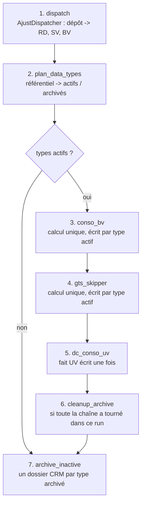
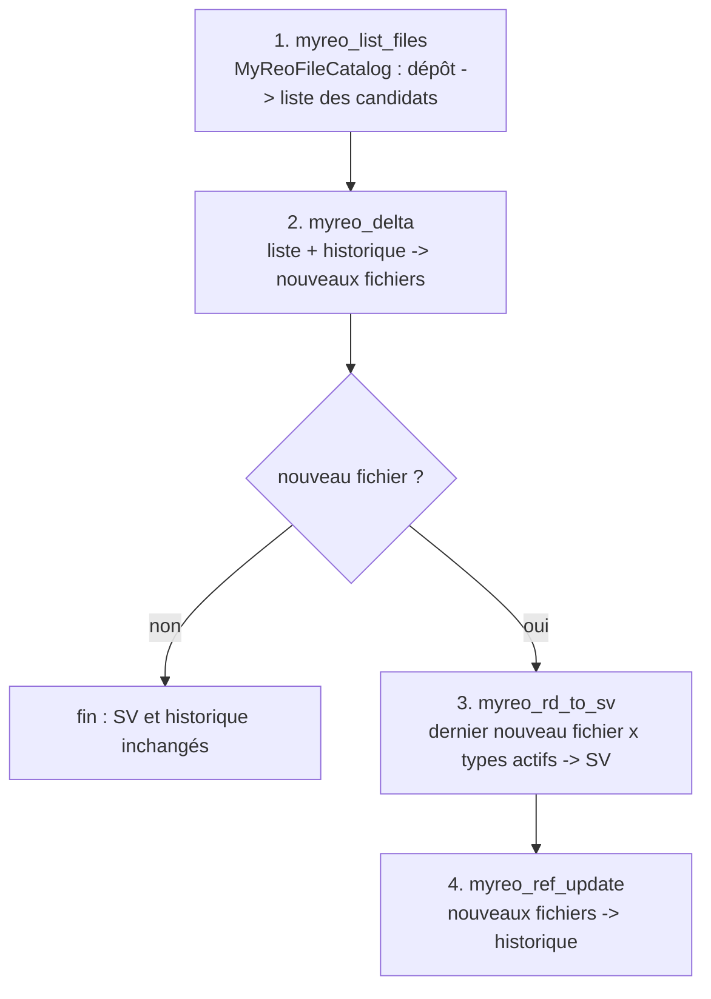
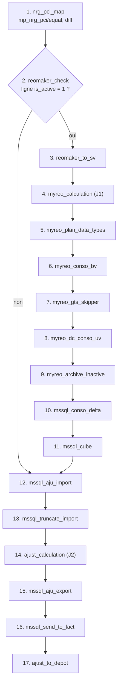

# Conception de la migration Scala / Spark des chaînes REO

Ce document décrit la cible des trois chaînes Talend migrées dans le projet `bsy_reo` :

- **AJUST** : `LUD_AJU_ORCHESTRATION_DELTA_REO`, analysée dans [ANALYSE_TALEND_LUD_AJU_ORCHESTRATION_DELTA_REO.md](ANALYSE_TALEND_LUD_AJU_ORCHESTRATION_DELTA_REO.md) ;
- **MYREO** : `LUD_MYREO_ORCHESTRATION_DATA_TO_SV`, analysée dans [ANALYSE_TALEND_LUD_MYREO_ORCHESTRATION_DATA_TO_SV.md](ANALYSE_TALEND_LUD_MYREO_ORCHESTRATION_DATA_TO_SV.md) ;
- **COVID** : `LUD_FLOW_AJUSTEMENT_REO_COVID`, analysée dans [ANALYSE_TALEND_LUD_FLOW_AJUSTEMENT_REO_COVID.md](ANALYSE_TALEND_LUD_FLOW_AJUSTEMENT_REO_COVID.md).

## 1. Principes

- **Même conception que le template FDA et EXP_ENG_FRG_SUV** : packages `job`, `common`, `mapping`, `utility` ; chaîne Driver -> FetchSource -> Runner -> Mapper (`AbstractMapperProvider`) -> requêtes Spark SQL d'un objet `Views` -> DataWriter.
- **Un projet, un driver par chaîne** : comme `MainDriverUV` et `MainDriverSUV` dans EXP_ENG_FRG_SUV, chaque chaîne a son driver, son FetchSource, son runner, ses mappers et son objet `Views`. Le socle est partagé.
- **Parité fonctionnelle avec Talend d'abord** : chaque requête cite le composant Talend qu'elle remplace ; les écarts sont listés au chapitre 10.
- **Corrections des faiblesses relevées sur EXP_ENG_FRG_SUV** : référentiels passés par nom et non par position, vues temporaires préfixées par mapper, garde-fou sur les racines partagées, configuration versionnée, tests de bout en bout.

## 2. Organisation du projet

| Élément | Commun | AJUST | MYREO | COVID |
|---|---|---|---|---|
| Driver | | `job.MainDriverAjustReo` | `job.MainDriverMyReo` | `job.MainDriverReo` |
| Sources | `utility.Utils` (lecteurs) | `common.FetchSourceAjustReo` | `common.FetchSourceMyReo` | `common.FetchSourceCovidReo` |
| Runner | `common.AbstractMapperProvider` | `common.AbstractPrimaryAjustReo`, `common.AjustReoRunner` | `common.AbstractPrimaryMyReo`, `common.MyReoRunner` | `common.AbstractPrimaryCovidReo`, `common.CovidReoRunner` |
| Mappers | | `mapping.MainMapperAjust*` | `mapping.MainMapperMyReo*` | `mapping.MainMapperCovid*`, et `MainMapperAjustConsoArch` réutilisé |
| Requêtes SQL | | `mapping.ViewsAjustReo` | `mapping.ViewsMyReo` | `mapping.ViewsCovidReo` (réutilise `yearFilterSql`, `dcConsoSql`, `activeTypesSql`) |
| Constantes | `utility.ReoConstants` | `utility.AjustReoConstants` | `utility.MyReoConstants` | `utility.CovidReoConstants` |
| Schémas | `utility.CustomSchemaReo` (référentiel des types) | `utility.CustomSchemaAjustReo` | `utility.CustomSchemaMyReo` | `utility.CustomSchemaCovidReo` (hérite des deux autres) |
| Règles Java | | | `utility.MyReoRules` | `utility.CovidRules` |
| SQL Server | | | | `utility.MssqlGateway`, `JdbcMssqlGateway`, `MsSqlServerConf`, `VaultManager`, `SparkIteratorBulkData` (modèle PUSHSQLSERVER) |
| Socle | `ReoConf`, `DataWriter`, `DataQuality`, `DataTypePlan`, `StepRunner`, `SparkSessionManager` | | | |
| Configuration | un fichier par driver, même structure, lue par `ReoConf` | `conf/reo_ajust.conf` | `conf/reo_myreo.conf` | `conf/reo_alim.conf` |
| Lancement | `bin/run_reo.sh <chaine> <env> <conf>` | `ajust` | `myreo` | `covid` |

Le référentiel des types de données ERK SV (`ajust/dtype`) est lu par les trois chaînes : sa table `REF_DATA_TYPE_SV` et son schéma sont dans le socle, et il est déclaré dans chacun des fichiers de configuration.

## 3. Chaîne AJUST : organisation des sous-jobs

### Avant / après

| | Talend | Scala |
|---|---|---|
| Applications | 2 jobs Standard + 4 jobs Spark : 3 applications YARN par type actif, 1 par type archivé | 1 application Spark |
| Passage des données | Fichiers Parquet relus entre jobs | DataFrames en mémoire, persistés ; relecture disque seulement en reprise |
| Conso et enrichissement | Recalculés pour chaque type actif | Calculés une fois, écrits dans le dossier de chaque type actif |
| Fait UV | Réécrit à chaque type actif dans le même dossier | Calculé et écrit une fois |
| Ordre | Ordre du référentiel, actifs et archivés mélangés | Chaîne des actifs d'abord, archivage ensuite |
| Reprise | Relance complète | Interrupteur par étape, l'étape suivante relit la sortie précédente sur disque |

Le calcul unique est strictement équivalent : le job Talend ne filtre pas les ajustements par type, donc tous les dossiers actifs reçoivent le même contenu (anomalie n°1 de l'analyse AJUST).

### Étapes

| Étape | Interrupteur | Remplace | Implémentation |
|---|---|---|---|
| 1 | `dispatch_trt` | sous-jobs fichiers du dispatch | `AjustDispatcher` (API FileSystem Hadoop) |
| 2 | toujours exécutée | tHDFSInput_4, tMap_4, tFlowToIterate | `AjustReoRunner.runDataTypePlan`, `DataTypePlan` |
| 3 | `conso_bv_trt` | REO_AJUST_CONSO_TO_BV_SPARK | `MainMapperAjustConsoBv` |
| 4 | `gts_skipper_trt` | LUD_REO_AJUST_CONSO_ADD_GTS_SKIPPER_TO_BV_SPARK | `MainMapperAjustConsoGtsSkipper` |
| 5 | `dc_conso_uv_trt` | LUD_REO_AJUST_DC_CONSO_GTS_SKIPPER_BV_TO_UV_SPARK_SP | `MainMapperAjustDcConsoUv` |
| 6 | `cleanup_archive_trt` | tHDFSDelete_2 | `AjustDispatcher.deleteArchive` |
| 7 | `archive_inactive_trt` | REO_AJUST_CONSO_TO_BV_SPARK_ARCH | `MainMapperAjustConsoArch` |

Le dispatch reste hors Spark : il copie et normalise des fichiers nommés, ce que l'API FileSystem fait exactement et sans fichiers `part-*`.

## 4. Chaîne MYREO : organisation des sous-jobs

### Avant / après

| | Talend | Scala |
|---|---|---|
| Applications | 1 job Standard + 1 JVM et 1 connexion Kerberos par nouveau fichier (tRunJob en processus indépendant) | 1 application Spark de petite taille (driver 2 Go) |
| Listing, liste des candidats, historique | tHDFSList, tHDFSInput, tHDFSOutput en APPEND | `MyReoFileCatalog` (API FileSystem), écriture temporaire puis renommage |
| Delta | tMap_1 en mémoire | requête `myreo_delta_sql` |
| Fichier SV | Réécrit pour chaque nouveau fichier : le dernier reste | Écrit une fois, à partir du dernier nouveau fichier |
| Historique | Complété fichier par fichier, après chaque appel du job enfant | Complété en une fois, seulement si le SV a été écrit dans le run |
| Reprise | Relance complète | Interrupteur par étape ; la liste des candidats est relue sur disque si le listing est désactivé |

Écrire le SV une seule fois donne exactement l'état final de Talend : chaque appel du job enfant écrasait le fichier, seul le dernier nouveau fichier dans l'ordre d'itération subsistait, et tous les nouveaux fichiers étaient marqués lus (anomalie n°1 de l'analyse MYREO).

### Étapes

| Étape | Interrupteur | Remplace | Implémentation |
|---|---|---|---|
| 1 | `myreo_list_files_trt` | tHDFSExist_1, tHDFSDelete_1, tHDFSList_1, tHDFSList_2, tMap_3, tHDFSOutput_2 | `MyReoFileCatalog.listCandidates`, `writeFileList` |
| 2 | toujours exécutée | tHDFSInput_2, tHDFSInput_1, tMap_1, tHashOutput_1 | `MainMapperMyReoDelta` |
| 3 | `myreo_rd_to_sv_trt` | tFlowToIterate_1, tRunJob_1 puis job enfant LUD_MYREO_REO_RD_TO_SV | `MainMapperMyReoRdToSv`, `DataWriter.writeSingleTextFile` |
| 4 | `myreo_ref_update_trt` | tFixedFlowInput_1, tMap_2, tHDFSOutput_1 | `MyReoFileCatalog.appendToRef` |

Le listing et l'historique restent hors Spark, comme le dispatch AJUST : ce sont des opérations sur des fichiers nommés. Le delta et la transformation sont en Spark SQL. Le fichier SV est écrit par Spark dans un dossier temporaire caché, puis le fichier `part-*` est renommé au nom attendu.

## 5. Chaîne COVID : organisation des sous-jobs

### Avant / après

| | Talend | Scala |
|---|---|---|
| Applications | 20 jobs : 7 applications Spark, 12 JVM Standard, une JVM et une connexion Kerberos par tRunJob, répétées par ligne active de `reomaker_active.csv` et par type de données | 1 application Spark |
| Table NRG -> PCI | calculée dans chaque conso MyREO (par type actif), puis par NRG_PCI_MAP | calculée une fois, en tête de chaîne |
| Bloc MyREO | exécuté une fois par ligne active du fichier de pilotage | exécuté une fois si au moins une ligne est active (même état final) |
| Ventilations J1 et J2 | deux jobs de 8 000 lignes de code généré, à la même topologie | un mapper paramétré par `VentilLayout` (colonnes et trois règles qui diffèrent) |
| Conso, enrichissement, fait UV MyREO | recalculés par type actif | calculés une fois, écrits par type actif ; fait UV écrit une fois |
| SQL Server | pilote jTDS, erreurs souvent avalées, vidage avant contrôle | pilote Microsoft, toute erreur arrête la chaîne, données contrôlées avant le vidage |
| Reprise | relance complète | interrupteur par étape ; l'étape suivante relit la sortie précédente sur disque |

### Étapes

| Étape | Interrupteur | Remplace | Implémentation |
|---|---|---|---|
| 1 | `nrg_pci_map_trt` | LUD_AJUST_REO_NRG_PCI_MAP_TO_SV_SPARK (et blocs A, B de la conso MyREO) | `MainMapperCovidNrgPciEqual`, `...OdsDiff`, `...Diff` |
| 2 | toujours exécutée | LUD_FLOW_MY_REO_TOOL, tHDFSInput_1 + tMap_1 | `CovidReoRunner.runReomakerCheck` |
| 3 | `reomaker_to_sv_trt` | MYREO_ORCHESTRATION_DATA_TO_SV -> MYREO_REO_RD_TO_SV | `MainMapperCovidReomakerToSv` |
| 4 | `myreo_calculation_trt` | LUD_AJUST_REO_CALCULATION_SPARK | `MainMapperCovidVentilation` (`VentilLayout.MYREO`) |
| 5 | toujours exécutée | MYREO_ORCHESTRATION_DTYPE | `DataTypePlan.fromDataFrame` |
| 6 | `myreo_conso_bv_trt` | LUD_AJUST_REO_CONSO_TO_BV_SPARK, bloc C | `MainMapperCovidMyReoConsoBv` |
| 7 | `myreo_gts_skipper_trt` | REO_CONSO_ADD_GTS_SKIPPER_TO_BV_SPARK_MY_REO | `MainMapperCovidMyReoGtsSkipper` |
| 8 | `myreo_dc_conso_uv_trt` | REO_CONSO_ADD_GTS_SKIPPER_ODS_TO_UV_SPARK_MY_REO | `MainMapperCovidMyReoDcConsoUv` |
| 9 | `myreo_archive_inactive_trt` | AJUST_REO_CONSO_TO_BV_SPARK_ARCH | `MainMapperAjustConsoArch` (même requête) |
| 10 | `mssql_conso_delta_trt` | LUD_EXP_SQLDB_CONSO_DATA_REO_FROM_UV_TO_MSSQL_STOCK + TRUNCATE_CONSO_REO_PROC_MSSQL | `MainMapperCovidDcConsoExport`, `MssqlGateway` |
| 11 | `mssql_cube_trt` | CUBE_PROC_MSSQL | `MssqlGateway.callProcedure` |
| 12 | `mssql_aju_import_trt` | LUD_REO_AJU_FROM_MSSQL_TO_HDFS | `MssqlGateway.query`, `MainMapperCovidAjuFromMssql` |
| 13 | `mssql_truncate_import_trt` | LUD_REO_TRUNCATE_HDFS_AJUSTEMENT_TO_FACT_TABLE | `MssqlGateway.callProcedure` |
| 14 | `ajust_calculation_trt` | LUD_REO_AJUST_CALCULATION_SPARK | `MainMapperCovidVentilation` (`VentilLayout.AJUST`) |
| 15 | `mssql_aju_export_trt` | LUD_REO_EXP_AJU_ADD_GTS_SKIPPER_FROM_HDFS_TO_MSSQL | `MainMapperCovidAjuExport`, `MssqlGateway.insert` |
| 16 | `mssql_send_to_fact_trt` | LUD_REO_SEND_HDFS_AJUSTEMENT_TO_FACT | `MssqlGateway.callProcedure` |
| 17 | `ajust_to_depot_trt` | LUD_REO_AJUST_ODS_TO_ARCHIVE | `MainMapperCovidAjustDepot` |

Entre deux étapes, la sortie est relue sur disque, comme les jobs Talend le faisaient : chaque étape reste rejouable seule. À l'intérieur d'une ventilation, les 14 branches restent en mémoire (persistées) ; elles sont écrites dans le dossier `ventil` pour la traçabilité, mais l'agrégat ne relit pas ce dossier.

SQL Server : `MssqlGateway` porte les trois opérations des jobs Talend (procédure `{? = call [dbo].<proc>(?)}`, lecture par requête, insertion par lots). Les tests de bout en bout utilisent une base simulée ; l'accès SQL Server n'est créé qu'au premier besoin, une chaîne dont les étapes SQL Server sont désactivées ne s'y connecte pas.

## 6. Architecture des classes

| Classe | Rôle | Équivalent template / EXP_ENG_FRG_SUV |
|---|---|---|
| `job.MainDriverAjustReo`, `job.MainDriverMyReo`, `job.MainDriverReo` | Point d'entrée d'une chaîne, orchestration des étapes, `run` testable | `MainDriver`, `MainDriverUV`, `MainDriverSUV` |
| `common.SparkSessionManager` | Session Spark, AQE, paramètres SQL par environnement | identique |
| `common.FetchSourceAjustReo`, `common.FetchSourceMyReo` | Une lazy val par source, options de lecture issues de la configuration | `FetchSource`, `FetchSourceUV` |
| `common.AbstractPrimaryAjustReo`, `common.AbstractPrimaryMyReo` | Exposent les sources, déclarent un traitement par sous-job | `AbstractPrimary`, `AbstractPrimaryUV` |
| `common.AjustReoRunner`, `common.MyReoRunner` | Instancient les mappers | `TemplateRunner`, `UvFrgRunner` |
| `common.AbstractMapperProvider` | Contrat d'un mapper | identique |
| `common.UvDimensions` | Les 14 référentiels UV passés par nom | nouveau |
| `common.StepRunner` | Traçage et fail-fast des étapes | remplace le socle de monitoring Talend |
| `mapping.MainMapperAjust*`, `mapping.MainMapperMyReo*` | Un mapper par job ou sous-job Talend de transformation | `MainMapper*` |
| `mapping.ViewsAjustReo`, `mapping.ViewsMyReo` | Toutes les requêtes Spark SQL d'une chaîne | `Views`, `ViewsUV`, `ViewsSUV` |
| `utility.CustomSchemaReo` et ses deux extensions | Schémas dans l'ordre exact des schémas Talend | `CustomSchemaUV` |
| `utility.ReoConf` | Lecture typée de la configuration, résolution des chemins | nouveau |
| `utility.Utils` | Lecteur CSV de la chaîne, lecteur ligne à ligne façon FileInputDelimited, formatage texte des lignes | `Utils` |
| `utility.DataWriter` | Écriture CSV, Parquet ou fichier texte unique, garde-fou des racines protégées | `DataWriter` |
| `utility.AjustDispatcher`, `AjustLineCodec` | Dispatch et normalisation des lignes AJUST | nouveau, règles pures testables comme `PoRefRules` |
| `utility.DataTypePlan` | Plan actifs / archivés AJUST | nouveau |
| `utility.MyReoFileCatalog` | Listing du dépôt MyREO, liste des candidats, historique des fichiers lus | nouveau |
| `utility.MyReoRules` | `SG_NumberUtils.toDouble` en UDF | nouveau |
| `utility.DataQuality` | Contrôles bloquants (`superphase_id`, `is_active`), alertes de doublons | nouveau |
| `job.MainDriverReo` | Chaîne COVID : 17 étapes, accès SQL Server injectable | `MainDriver` |
| `mapping.VentilLayout`, `mapping.MainMapperCovidVentilation` | Ventilation commune aux deux jobs de calcul, paramétrée par la disposition des colonnes | nouveau |
| `utility.CovidRules` | `BigDecimal.multiply(x, DECIMAL64 / DECIMAL32)`, `Integer.parseInt`, `parseTo_Double` en UDF | nouveau |
| `utility.MssqlGateway`, `JdbcMssqlGateway`, `MsSqlServerConf`, `VaultManager`, `SparkIteratorBulkData` | Procédures, lecture et insertion SQL Server (SQLServerBulkCopy) ; connexion par environnement, compte et mot de passe lus dans Vault, comme PUSHSQLSERVER | remplace tMSSqlConnection, tMSSqlSP, tMSSqlInput, tMSSqlOutput |

## 7. Correspondance composants Talend -> Spark SQL

Chaîne AJUST, requêtes de `mapping/ViewsAjustReo.scala` :

| Job Talend | Composants | Requête |
|---|---|---|
| CONSO_TO_BV | tMap_1 | `conso_to_agg_sql` |
| CONSO_TO_BV | tSqlRow_1 | `conso_year_filter_sql` = `yearFilterSql(...)` |
| CONSO_TO_BV | tAggregateRow_1 | `conso_aggregate_sql` |
| CONSO_TO_BV_ARCH | tSqlRow_1 | `arch_year_filter_sql` |
| ADD_GTS_SKIPPER | tMap_4, tMap_5, tMap_6, tMap_1 | `gts_skipper_enrich_sql` (une CTE par tMap) |
| DC_CONSO_UV | tSqlRow_1 | `uv_super_phase_code_sql` |
| DC_CONSO_UV | tSqlRow_2 | `uv_super_phase_check_sql` |
| DC_CONSO_UV | tMap_6, 1, 2, 3, 4, 5, 8, 9, 10, 11, 13, 7, 12, 14 | `uv_dc_conso_sql` (une CTE `d_*` par référentiel) |

Chaîne MYREO, requêtes de `mapping/ViewsMyReo.scala` :

| Job Talend | Composants | Requête |
|---|---|---|
| Orchestrateur | tMap_1 (et filtre du tMap_3) | `myreo_delta_sql` |
| Job enfant | tHDFSInput_2 et filtre de lookup du tMap_1 | `myreo_active_types_sql` |
| Job enfant | tMap_1, sortie `out_aju_reo` | `myreo_rd_to_sv_sql` |
| Contrôle qualité | aucun équivalent Talend | `myreo_amount_check_sql` |

Chaîne COVID, requêtes de `mapping/ViewsCovidReo.scala` :

| Job Talend | Composants | Requête |
|---|---|---|
| NRG_PCI_MAP | tSqlRow_1 | `nrg_out1_sql` |
| NRG_PCI_MAP | tMap_3 (equal) | `nrg_equal_sql` |
| NRG_PCI_MAP | tMap_2 (to_diff, to_diff9) | `nrgToDiffSql(startsWith9)` |
| NRG_PCI_MAP | tSqlRow_7 / _6, tSqlRow_3 / _5 | `nrg_count_filter_sql`, `nrg_min_pci_sql` |
| NRG_PCI_MAP | tSqlRow_4, tSqlRow_2 | `nrg_diff_candidates_sql`, `nrg_diff_sql` |
| MY_REO_TOOL | tMap_1 | `reomaker_active_count_sql` |
| MYREO_REO_RD_TO_SV | lookup filtré, tMap_1 | `reomaker_active_types_sql` (= `ViewsMyReo.activeTypesSql`), `reomaker_to_sv_sql` |
| J1 / J2 | tSqlRow_6 / tSqlRow_1 + tSqlRow_8 + tMap_14 | `myreo_ytd_sql`, `ajust_ytd_sql` |
| J1 / J2 | tSqlRow_2 + tMap_1 (MTD) | `ventilMtdSql(layout)` |
| J1 / J2 | tSqlRow_3, 4, 5 + tMap_2, 3, 4 (QTD, FQ, FY) | `ventilCumulSql(layout, cumul, mapping)` |
| J1 / J2 | tSqlRow_9, 10 (effectifs MTD, QTD) | `ventilEtpCopySql(layout, cumul)` |
| J1 / J2 | tSqlRow_13, 15, 16, 17, 19, 21, 23 (correspondances datées) | `etpDatedMappingSql(layout, mapping)` |
| J1 / J2 | tSqlRow_11, 12, 14, 18, 20, 22, 24 + post-processors | `ventilEtpShiftSql(layout, ...)` |
| J1 / J2 | tAggregateRow_1 + tSqlRow_7 | `ventilAggregateSql(layout)` |
| CONSO_TO_BV MyREO | tSqlRow_9, tMap_1, tSqlRow_8 | `conso_mp_sql`, `conso_to_agg_sql`, `conso_year_filter_sql` (= `yearFilterSql`) |
| GTS_SKIPPER MyREO | tMap_1, 2, 3, 4 | `gts_skipper_enrich_sql` |
| ODS_TO_UV MyREO | tSqlRow_1, tSqlRow_2, 14 tMap, tSqlRow_3 | `uv_super_phase_code_sql`, `uv_super_phase_check_sql`, `uv_dc_conso_sql` (= `ViewsAjustReo.dcConsoSql`), `uv_not_null_sql` |
| AJU_FROM_MSSQL | tMap_3 | `mssql_aju_sql` |
| EXP_AJU_ADD_GTS | tMap_1, 2, 4, 3, 5 | `export_aju_sql` |
| LUD_EXP_SQLDB | tHDFSInput_1 -> tDBOutput_1 | `export_dc_conso_sql` |
| ODS_TO_ARCHIVE | tMap_1, tMap_2 | `depotCopySql(columns)` |

Règles de traduction :

| Talend | Spark SQL |
|---|---|
| Lookup tMap `LEFT_OUTER` + `UNIQUE` | `LEFT JOIN` sur un lookup dédoublonné par clé : `MIN(id)` ou `ROW_NUMBER() = 1` sur un ordre déterministe |
| Lookup tMap `ALL_ROWS` sans clé, avec filtre | `CROSS JOIN` sur la CTE filtrée ; ligne nulle ajoutée si le lookup est vide (passage forcé de Talend) |
| Filtre d'expression d'un lookup `isNotBlank(x)` | `WHERE x IS NOT NULL AND TRIM(x) <> ''` dans la CTE |
| "Use replicated join" | hint `/*+ BROADCAST(...) */` |
| `SG_StringUtils.trim(x)` | `TRIM(x)` |
| `SG_StringUtils.substring(x, 0, 4)` / `substring(x, -2)` | `SUBSTRING(x, 1, 4)` / `SUBSTRING(x, -2)` |
| `SG_StringUtils.substring(x, 1, -1)` | `SUBSTRING(x, 2, LENGTH(x) - 2)` |
| `SG_NumberUtils.toDouble(x)` | UDF `myreo_to_double` : `Double.parseDouble`, 0.0 par défaut |
| `x == null ? "" : x` puis `equals(.., "") ? "NA" : ..` | `CASE WHEN COALESCE(x, '') = '' THEN 'NA' ELSE x END` |
| tSqlRow | requête recopiée telle quelle, seuls les noms de vues changent |
| tAggregateRow `sum`, IGNORE_NULL | `SUM` + `GROUP BY`, recasté en `DECIMAL(32,16)` |
| tFileInputDelimited d'un job Spark, "CSV options" décochées | lecteur CSV Spark avec `quote = \u0000`, schéma imposé |
| FileInputDelimited d'un job Standard (lignes vides gardées, champ absent à `""`) | `Utils.readRawDelimited`, puis `COALESCE(x, '')` en tête de requête |
| TRIMALL | `ignoreLeadingWhiteSpace` / `ignoreTrailingWhiteSpace` |
| Ordre des lignes d'un job Standard | colonne `line_no`, `ORDER BY`, écriture par `coalesce(1)` |
| `StringBuilder.append(Double)` | `Utils.toDelimitedLines` : `Double.toString` |
| `SG_StringUtils.equals(a, b)` (null-safe) | `a <=> b` |
| `BigDecimal.multiply(x, MathContext.DECIMAL64 / DECIMAL32)` | UDF `covid_mul64` / `covid_mul32`, arrondi par ligne puis échelle 16 |
| `StringHandling.CHANGE(x, "GD1", "GD2")` | `REGEXP_REPLACE(x, 'GD1', 'GD2')` |
| Clés vides d'un job Standard (`""` égal à `""`) | `COALESCE(x, '')` des deux côtés de la jointure |
| tMSSqlSP, tMSSqlInput, tMSSqlOutput | `MssqlGateway` : CallableStatement côté driver, lecture et écriture JDBC Spark |

## 8. Modèle de données

Chaîne AJUST :

| Couche | Données | Format | Granularité |
|---|---|---|---|
| RD | historique des fichiers détail | texte `;` UTF-8 | un fichier par run, un dossier par jour |
| SV | dernier fichier détail | texte `;` UTF-8 | ajustement |
| BV | dernier fichier agrégé | texte `;` UTF-8 | ajustement |
| BV conso | conso par type actif | Parquet, 11 colonnes, `DECIMAL(32,16)` | 10 axes + montant |
| WP ODS | conso enrichie par type actif | Parquet, 14 colonnes | 10 axes + 3 codes GTS / classification + montant |
| UV | fait `dc_conso` | CSV `;` sans en-tête, 15 colonnes | 14 clés de dimensions + montant |
| BV CRM | archive par type inactif | Parquet, 11 colonnes | 10 axes + montant |

Le fait UV ne porte que des identifiants techniques. Ceux-ci viennent des référentiels UV produits par d'autres chaînes : la stabilité des identifiants dépend de ces chaînes, pas de celle-ci.

Chaîne MYREO :

| Couche | Données | Format | Granularité |
|---|---|---|---|
| RD | extractions de l'outil MyREO, un dossier par dépôt | texte `;` UTF-8, 1 ligne d'en-tête, valeurs entre guillemets | ligne d'ajustement de l'outil |
| WP | liste des candidats, historique des fichiers lus | texte `;` UTF-8 | fichier déposé |
| SV | `my_reo/Extract_Ajus_Outil_REO_pour_BSY_REO.csv` | texte `;` sans en-tête, 10 colonnes, montant `Double` | ligne d'ajustement × type de données actif |

Chaîne COVID :

| Couche | Données | Format | Granularité |
|---|---|---|---|
| SV ERK | table NRG -> PCI `mp_nrg_pci/{equal,diff}` | dossiers CSV `;` | sous-NRG -> compte |
| SV | fichier SV REOMAKER (même fichier que MYREO) | texte `;`, 10 colonnes, montant `Double` | ligne REOMAKER × type actif |
| WP | ventilations et agrégats `my_reo/aju`, `ajust/aju` | texte `;`, `DECIMAL(32,16)` sans exposant | 9 axes (MyREO) ou 18 colonnes (SQL Server) |
| WP / BV | conso, conso enrichie, archive MyREO | Parquet non compressé, 11 ou 14 colonnes | comme AJUST |
| UV | fait `dc_conso/my_reo/conso_reo.csv` | texte `;`, 15 colonnes | 14 clés + montant |
| WP | extraction `ajust/aju/sql/aju.csv`, dépôt `ajust/aju/archive` | texte `;` UTF-8, 19 colonnes | ajustement |
| SQL Server | `dc_conso_delta`, `hdfs_import_ajustment_reo` | tables, insertion par lots | comme les fichiers source |

## 9. Configuration

Chaque driver a son fichier de configuration, déposé sur HDFS et passé en 2e argument :

| Fichier | Driver | Contenu propre à la chaîne |
|---|---|---|
| `conf/reo_ajust.conf` | `MainDriverAjustReo` | 12 racines, interrupteurs AJUST, `on_missing_archive`, `timezone`, `output_partitions`, tables AJUST, CONSO, LK et DIM |
| `conf/reo_myreo.conf` | `MainDriverMyReo` | 4 racines : `raw`, `sv_reo`, `erk_sv`, `wp_reo` ; interrupteurs MYREO, `myreo_on_missing_ref`, tables MYREO |
| `conf/reo_alim.conf` | `MainDriverReo` | 12 racines (dont `erk_sv_reo`, la racine SV ERK de la table NRG -> PCI) ; 15 interrupteurs ; connexion SQL Server par environnement ; tables COVID, et tables LK, DIM, YEAR_MAPPING identiques à AJUST |

Les trois fichiers ont la même structure, lue par la même classe `ReoConf` :

- `dfin.bsy.reo.roots.<env>` : les racines des contextes Talend utilisées par la chaîne.
- `dfin.bsy.<TABLE>` : racine et chemin relatif, options de lecture (`input_delimiter`, `input_header`, `input_trim`, `input_encoding`) ou d'écriture (`output_format`, `output_delimiter`, `output_compression`, `output_partitions`).
- Exception d'un environnement : `dfin.bsy.<TABLE>.path_input.<env>` ou `output_path.<env>`, convention d'EXP_ENG_FRG_SUV, prioritaire.
- `dfin.bsy.reo.protected_roots.<env>` : racines que la chaîne refuse d'écraser. AJUST protège les référentiels ERE, ERK, GZH, USG, ERK SV, les lookups GTS et le dépôt MyREO. MYREO protège le référentiel ERK SV et son dépôt.
- `dfin.bsy.reo.<etape>_trt` : interrupteur de chaque étape de la chaîne, actif par défaut.
- `dfin.bsy.reo.spark_sql_conf.<env>` : valeurs des contextes Talend pour AJUST, 20 ou 240 partitions de shuffle. MYREO en garde 4 : ses jobs Talend étaient des jobs Standard, sans Spark.
- AJUST : `dfin.bsy.reo.on_missing_archive` vaut `EMPTY` (comportement Talend) ou `SKIP`.
- MYREO : `MYREO_RD_FILES` porte le dépôt, les masques `dir_masks` et `file_masks`, et le format des extractions. `MYREO_NEW_FILES`, `MYREO_REF_FILES` et `MYREO_SV` portent les trois fichiers produits. `dfin.bsy.reo.myreo_on_missing_ref` vaut `EMPTY` (historique vide) ou `FAIL` (arrêt, comme Talend).

Les racines et les tables communes figurent dans plusieurs fichiers : un changement doit être reporté partout. Le test `ConfFilesSpec` le vérifie (racines, référentiel des types, tables LK et DIM, liens entre chaînes : fichier SV MyREO commun, dépôt AJUST écrit par COVID), et contrôle que chaque fichier résout tous les chemins de son driver dans les quatre environnements, sans table d'une autre chaîne.

SQL Server (COVID), même modèle que le projet PUSHSQLSERVER : `dfin.bsy.reo.mssqlserver` porte l'accès Vault commun aux environnements (`address`, `namespace`, `authPath`, `secretPath`, `engineVersion`, `userKey`, `passwordKey`), puis par environnement `server`, `port`, `instanceName`, `dbName`, `schema` et `trustServerCertificate` (valeurs des contextes Talend `cxnMSSQL_*`). L'URL est celle de PUSHSQLSERVER (`jdbc:sqlserver://…;instanceName=…;database=…;integratedSecurity=false;encrypt=true;trustServerCertificate=…`). Le compte et le mot de passe sont lus dans Vault par AppRole (bibliothèque vault-java-driver) : `roleId` et `secretId` sont dans le fichier `vault.conf` désigné par la variable `vault_config_file`, que `bin/run_reo.sh` envoie au driver YARN. Résolution, comme PUSHSQLSERVER : Vault avec `vault.retryMaxAttempts` tentatives, puis la section de secours de `vault.conf` si `vault.fallback.enabled`, puis `<env>.user` / `<env>.password` en clair (dernier recours, jamais en production). `mssql_on_proc_error` (`WARN` par défaut, comme Talend, ou `FAIL`) décide du sort d'un code retour non nul de procédure ; `mssql_query_timeout` borne les requêtes et les procédures.

Les Jenkinsfiles déploient les trois fichiers : un appel Ansible Tower par fichier, car le modèle repris du template ne prend qu'un `application_conf` par appel.

## 10. Écarts assumés par rapport à Talend

Chaîne AJUST :

| Écart | Justification |
|---|---|
| Doublons des lookups "correspondance unique" résolus par `MIN(id)` | Talend garde une ligne selon l'ordre physique, irreproductible ; même convention qu'EXP_ENG_FRG_SUV |
| Conso, enrichissement et fait UV calculés une fois | Contenu identique par construction ; aucun recalcul pour les types actifs suivants |
| Archivage exécuté après la chaîne des actifs, type archivé sans dossier ignoré avec alerte | Une archive manquante ne bloque plus la production du fait UV |
| Suppression du dépôt seulement si dispatch, conso, enrichissement et fait UV ont tourné dans le run | En reprise partielle, le dépôt n'est jamais perdu avant d'avoir été historisé et répercuté jusqu'au fait UV |
| Dispatch : un seul fichier RD par run, écriture temporaire puis renommage, fichiers cachés et lignes vides ignorés | Pas de fichier tronqué, pas de `_SUCCESS` pris pour un dépôt |
| `superphase_id` nul : arrêt explicite | Contrat NOT NULL Talend (int primitif) ; signale un référentiel super-phase sans code `NC` |
| `is_active` vide, code de type vide, type à la fois actif et archivé : arrêt avec message | Talend échouait sur NullPointerException ou lançait les jobs avec `dtype = null` |
| Chaîne vide restaurée sur les colonnes NOT NULL du fichier AJUST | Talend lit un champ vide comme `""`, Spark comme `null` |
| Montants CSV écrits avec `toPlainString` | Spark écrirait `0E-16` pour un zéro `DECIMAL(32,16)` |
| Valeur non numérique dans un référentiel : null au lieu d'un arrêt | Mode PERMISSIVE du lecteur Spark ; à surveiller en recette |
| Parquet non compressé conservé | Compatibilité stricte ; `output_compression = "snappy"` recommandé après recette |

Chaîne MYREO :

| Écart | Justification |
|---|---|
| SV écrit une fois, à partir du dernier nouveau fichier | État final identique à Talend, sans une JVM et une réécriture par fichier |
| Historique complété en une fois, après l'écriture du SV | Tout ou rien : un échec ne laisse jamais un fichier marqué lu sans SV correspondant. Talend pouvait laisser un état partiel |
| Historique absent traité comme vide par défaut ; `FAIL` rétablit l'arrêt Talend | Le premier run n'exige plus de créer l'historique à la main |
| Dépôt sans aucun fichier : liste vide écrite, SV et historique inchangés | Talend échouait sur la liste absente |
| Dossiers comparés sans schéma ni autorité (`hdfs://HDFS-LUDP01`) ; historique écrit avec l'URI complète, comme Talend | Un changement d'écriture du nameservice ne fait pas rejouer tout le dépôt |
| Chemin lu = URI du dossier + nom du fichier | Talend recalculait le chemin avec `substringAfter(deleteWhitespace(...))`, faux pour un dossier contenant un espace |
| Historique dédoublonné dans le delta, fichier retenu par deux masques listé une fois | Talend itérait une fois par doublon, sans effet sur les données |
| Ligne vide du référentiel des types ignorée | Lecteur CSV Spark ; Talend s'arrêtait sur NullPointerException |
| Historique sans `\n` final : un `\n` est ajouté avant les nouvelles lignes | Talend aurait collé deux lignes |
| Alertes de qualité : montants convertis à 0.0, lignes CRLF, doublons d'historique | La règle Talend est conservée, mais rendue visible dans les logs |

Chaîne COVID :

| Écart | Justification |
|---|---|
| Table NRG -> PCI calculée une fois, en tête de chaîne | Talend la calculait à l'identique dans chaque conso MyREO, puis dans NRG_PCI_MAP |
| Bloc MyREO exécuté une fois si au moins une ligne de `reomaker_active.csv` vaut `"1"` | Talend l'exécutait une fois par ligne active, avec les mêmes paramètres : état final identique (vidages et insertions SQL Server compris) |
| Listing du dépôt MyREO, liste NEW et ligne `;;1` de l'historique MYREO non repris | Sans usage dans la chaîne COVID, et en collision avec la chaîne MYREO (dépôt lu en DEV même en production) |
| J1 lit le fichier SV MyREO à son chemin voulu | Talend lisait `sv_reo` suivi de deux tabulations (valeur DEV de `AJU_REO_IN`) |
| Montant de la conso MyREO en `DECIMAL(32,16)`, alerte sur les montants hors du `DECIMAL(17,12)` Talend | Le lecteur Talend perdait ou rejetait les montants de 100 000 et plus |
| Agrégats des ventilations calculés sur les branches en mémoire | Un fichier résiduel du dossier `ventil` n'est plus sommé |
| Correspondances uniques dédoublonnées sur un ordre déterministe | Talend gardait une ligne arbitraire |
| Fait UV MyREO : lignes écartées par le filtre NOT NULL comptées dans les logs, par clé nulle | Talend les supprimait sans trace |
| Sorties de mise au point `ods/temp/sortie1.csv` et `sortie2.csv` non produites | Aucun consommateur |
| Contrôles avant écriture : montant REOMAKER invalide, colonne nulle de `ajustment_reo`, date illisible, valeur non numérique du fait UV | Talend ouvrait ses sorties (ou vidait ses tables) avant de lire, et plusieurs jobs avalaient l'erreur (code 0) |
| Fait UV exporté vers `dc_conso_delta` contrôlé avant l'appel de la procédure de vidage | Une valeur invalide ne laisse plus la table vide |
| Toute erreur SQL Server arrête la chaîne ; insertion par SQLServerBulkCopy, lots validés au fil de l'eau (autocommit) comme Talend et PUSHSQLSERVER | Talend ignorait les lots en échec et continuait. Un lot déjà validé reste en base : la relance repart du vidage par procédure |
| Requête d'extraction à colonnes nommées | Talend lisait `select *` par position |
| Pilote Microsoft `mssql-jdbc` au lieu de jTDS, identifiants dans Vault | Même modèle que PUSHSQLSERVER ; plus aucun mot de passe dans un contexte ni dans les logs (`tContextDump`) |
| Code retour non nul d'une procédure : alerte par défaut, arrêt avec `mssql_on_proc_error = FAIL` | Contrat des procédures `p_api_*` inconnu ; Talend ne le testait pas |

## 11. Plan de recette

Chaîne AJUST :

1. Copier le dépôt `wp_reo/ajust/aju/archive` dans un bac à sable avant le run Talend : Talend le supprime en fin de chaîne.
2. Déclarer l'environnement de recette `roots.rec` dans `reo_ajust.conf`, à partir de l'exemple fourni : sorties `raw`, `sv_reo`, `bv_reo`, `bv`, `wp_reo`, `uv_reo` dans le bac à sable, référentiels pointant sur les données réelles.
3. Lancer `bin/run_reo.sh ajust rec ...` puis comparer avec `docs/recette_comparaison.sql` (EXCEPT ALL dans les deux sens, par sortie).
4. Points d'attention : choix de la ligne retenue sur les doublons de référentiels, format des montants dans le CSV UV, chaînes vides contre null.

Chaîne MYREO :

1. Copier l'historique `wp_reo/params/my_reo/myreo_path_ref_files.csv` dans le bac à sable avant le run Talend : Talend le complète.
2. Déclarer l'environnement de recette `roots.rec` dans `reo_myreo.conf`, à partir de l'exemple fourni : `wp_reo` et `sv_reo` dans le bac à sable, dépôt `raw` et référentiel `erk_sv` lus sur HOM et protégés.
3. Lancer `bin/run_reo.sh myreo rec ...`, puis comparer le fichier SV et l'historique avec le chapitre MYREO de `docs/recette_comparaison.sql`.
4. Points d'attention : plusieurs nouveaux fichiers dans le même run, ordre `*.RECU` puis `*.PRET`, format des montants `Double`, URI des dossiers dans l'historique.

Chaîne COVID :

1. Sauvegarder avant le run Talend les sorties que la chaîne écrase : fichier SV MyREO, `mp_nrg_pci`, `wp_reo/my_reo`, `wp_reo/ajust/aju`, fait UV `dc_conso/my_reo`, et les tables `dc_conso_delta` et `hdfs_import_ajustment_reo`.
2. Déclarer `roots.rec` dans `reo_alim.conf` (sorties dans un bac à sable, référentiels lus sur HOM) et une base SQL Server de recette dans `mssql.rec`, ou désactiver les étapes `mssql_*` et comparer les DataFrames avant insertion.
3. Comparer agrégats, conso, fait UV et fichiers du dépôt AJUST avec `docs/recette_comparaison.sql`.
4. Points d'attention : chemin du SV lu par J1 en production (anomalie 1 de l'analyse), montants de 100 000 et plus dans la conso MyREO, taux FQM / FYM, arrondis `DECIMAL32` des effectifs, format des montants dans les fichiers texte.

## 12. Tests

`mvn test` lance 204 tests. `ConfFilesSpec` et `CovidConfFileSpec` contrôlent les trois fichiers de configuration. Douze scénarios de bout en bout tournent sur système de fichiers local, chacun avec le fichier de configuration de son driver :

- **AJUST** : chaîne complète, reprise du seul fait UV, chaîne partielle qui conserve le dépôt ;
- **MYREO** : premier run avec historique existant, run sans nouveau fichier, SV désactivé puis réactivé, reprise sans listing, historique absent en `FAIL` puis en `EMPTY` ;
- **COVID** (base SQL Server simulée, qui trace les appels et garde les lignes insérées) : chaîne complète des 17 étapes, fichier de pilotage sans ligne active et procédure en échec (`WARN` puis `FAIL`), reprise sans SQL Server ni table NRG -> PCI (aucune connexion ouverte), sortie dans une racine protégée.

Les règles de chaque job COVID sont testées par mapper (`MainMapperCovid*Spec`), dont les deux ventilations sur un même jeu de paramètres ; l'appel de procédure JDBC, la résolution des identifiants (Vault, secours de `vault.conf`, valeurs en clair) et l'alignement des colonnes de l'insertion le sont dans `MssqlGatewaySpec` et `SparkIteratorBulkDataSpec`.

La couverture est mesurée par `mvn scoverage:report` : 92,2 % des instructions et 78,6 % des branches, drivers compris. Sonar exclut les drivers de la couverture, via la propriété `sonar.coverage.exclusions` du pom. L'implémentation JDBC de la lecture et de l'insertion n'est pas couverte : elle demande une base SQL Server.
